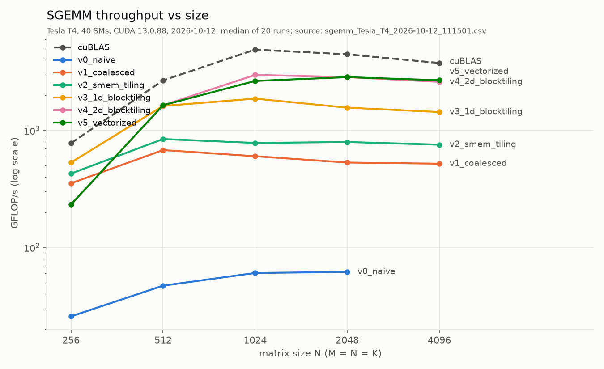
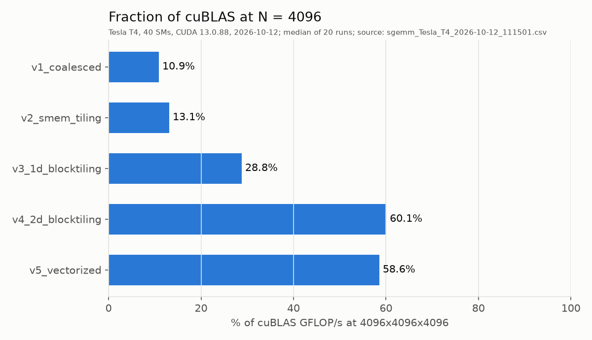
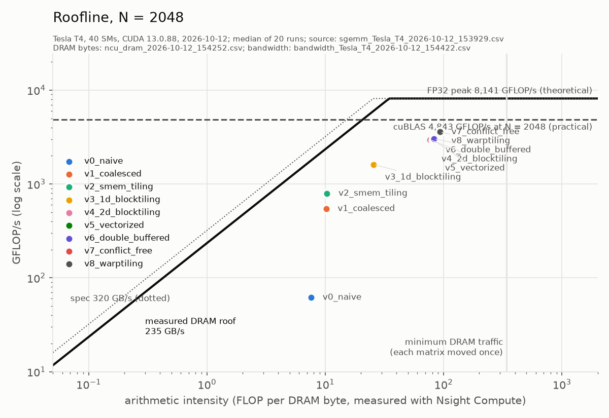

<!-- GENERATED by scripts/make_tables.py from docs/README.template.md and results/*.csv. Edit the template, not this file. -->

# cuda-sgemm: SGEMM from a naive kernel toward cuBLAS on an NVIDIA T4

Single-precision matrix multiply (C = A·B, row-major FP32) written in CUDA C++ and optimized
one idea at a time. Each step is measured on a Tesla T4, checked against cuBLAS, profiled with
Nsight Compute, and explained in terms of memory coalescing, data reuse, occupancy and
instruction mix. **Every number in this README is generated from the CSVs in
[`results/`](results/)** by [`scripts/make_tables.py`](scripts/make_tables.py); none is typed
by hand.

**Result.** The fastest kernel, `v6_double_buffered`, reaches **2,884
GFLOP/s at N = 4096, 60.4% of cuBLAS** timed in the same thermal state
(63.4% at N = 2048). That is 50.6x
the naive kernel at N = 2048. All 48 of 48 kernel/size results pass the cuBLAS check
(largest normwise relative error 2.2e-06, tolerance 1e-04), including the non-multiple
sizes 1000 and 1023.

Main findings:

- **Register tiling is where the speed comes from.** Coalescing and shared-memory tiling
  (v1, v2) leave the kernel at 13.1% of cuBLAS. Making each thread compute a
  column of 8 outputs (v3) and then an 8×8 tile (v4) is what gets it to 58.5%: shared-memory loads per
  FMA drop from 1.250 to 0.062, and
  DRAM traffic falls to 4.5x the minimum.
- **Two textbook optimizations did little here, and the counters show why.** The compiler had
  already turned v4's shared-memory reads into 128-bit loads, so hand-vectorizing (v5) changed
  nothing measurable. Two resident blocks per SM already overlap one block's loads with the
  other's math, so double buffering (v6) adds only 1.04x at N = 4096.
- **The T4 is power-limited.** Under a dense FFMA load the SM clock drops far below its
  1590 MHz boost. To compare kernels fairly, the harness times cuBLAS interleaved with every
  kernel, and records the clock and power after each measurement.

## Results



**N = 4096** (M = N = K), GFLOP/s from the median of the timed runs:

| kernel | GFLOP/s | median ms | min – p90 ms | % cuBLAS | max rel err | check |
|---|---|---|---|---|---|---|
| cuBLAS | 4,118 | 33.37 | 23.41 – 33.75 | 100% (ref) | reference | REF |
| `v1_coalesced` | 554 | 248.17 | 225.75 – 250.08 | 10.7% | 0.0e+00 | PASS |
| `v2_smem_tiling` | 807 | 170.23 | 149.69 – 172.20 | 13.1% | 0.0e+00 | PASS |
| `v3_1d_blocktiling` | 1,535 | 89.53 | 66.13 – 90.50 | 29.6% | 0.0e+00 | PASS |
| `v4_2d_blocktiling` | 2,716 | 50.60 | 28.08 – 52.21 | 58.5% | 0.0e+00 | PASS |
| `v5_vectorized` | 2,806 | 48.97 | 29.43 – 51.15 | 58.3% | 0.0e+00 | PASS |
| `v6_double_buffered` | 2,884 | 47.66 | 27.41 – 49.89 | 60.4% | 0.0e+00 | PASS |

Not run at this size: `v0_naive` (largest size run: 2048).

| GFLOP/s | N=256 | N=512 | N=1000 | N=1023 | N=1024 | N=2048 | N=4096 |
|---|---|---|---|---|---|---|---|
| cuBLAS | 712 | 2,344 | 5,837 | 5,819 | 6,096 | 5,081 | 4,118 |
| `v0_naive` | 26 | 28 | 110 | 187 | 60 | 62 |  |
| `v1_coalesced` | 344 | 767 | 693 | 657 | 654 | 562 | 554 |
| `v2_smem_tiling` | 410 | 950 | 930 | 947 | 913 | 849 | 807 |
| `v3_1d_blocktiling` | 484 | 1,833 | 2,045 | 2,075 | 2,135 | 1,724 | 1,535 |
| `v4_2d_blocktiling` | 215 | 1,854 | 3,415 | 3,439 | 3,554 | 3,019 | 2,716 |
| `v5_vectorized` | 214 | 1,835 | 3,254 | 3,065 | 3,591 | 3,089 | 2,806 |
| `v6_double_buffered` | 232 | 2,057 | 3,407 | 3,160 | 3,461 | 3,121 | 2,884 |



### Roofline



- **Memory roof:** the **measured** DRAM bandwidth, 234 GB/s (73% of the
  320 GB/s spec), from [`src/bandwidth.cu`](src/bandwidth.cu).
- **Compute roof:** the theoretical FP32 peak, 8,141 GFLOP/s (40 SMs × 64 FP32 lanes ×
  1590 MHz boost × 2 for FMA). It is labelled theoretical because the T4 can't hold that clock
  under load (see Methodology).
- **Practical ceiling:** cuBLAS.
- **Each kernel's arithmetic intensity is measured:** 2·N³ FLOPs divided by the DRAM bytes
  Nsight Compute counted for that kernel at N = 2048.
- The roofs meet at 35 FLOP/byte. The vertical line is the best possible intensity at
  this size, 341 FLOP/byte, which is A and B read once and C written once.

How to read it: v0–v2 sit far *below* the DRAM roof, so DRAM bandwidth isn't what limits them.
They are limited inside the SM, by how many load instructions the L1/shared-memory path can
serve. v4–v6 sit to the *right* of the ridge (76.6–82.8
FLOP/byte), so DRAM is no longer the limit at all. What remains is how fast the SM can issue
FMAs at the clock it can sustain.

Nsight Compute counters at N = 2048 (last of 2 profiled launches per kernel):

| kernel | DRAM MB moved | vs minimum | FLOP per DRAM byte | global sectors per load request | L1 hit | L2 hit | shared loads per FFMA (warp-level) | shared-load bank conflicts | shared-store bank conflicts | FFMA share of instructions |
|---|---|---|---|---|---|---|---|---|---|---|
| `v0_naive` | 2,258 | 44.9x | 7.6 | 16.5 | 99.2% | 76.5% | 0.000 | 0 | 0 | 22% |
| `v1_coalesced` | 1,683 | 33.4x | 10.2 | 2.5 | 95.0% | 49.8% | 0.000 | 0 | 0 | 22% |
| `v2_smem_tiling` | 1,664 | 33.1x | 10.3 | 4.0 | 0.0% | 48.5% | 1.250 | 0 | 0 | 33% |
| `v3_1d_blocktiling` | 672 | 13.3x | 25.6 | 4.0 | 0.1% | 60.6% | 0.375 | 0 | 0 | 53% |
| `v4_2d_blocktiling` | 224 | 4.5x | 76.6 | 3.9 | 17.9% | 80.4% | 0.062 | 33,554,432 | 0 | 83% |
| `v5_vectorized` | 211 | 4.2x | 81.4 | 15.8 | 17.9% | 80.1% | 0.062 | 33,554,432 | 2,097,152 | 88% |
| `v6_double_buffered` | 207 | 4.1x | 82.8 | 15.8 | 17.8% | 80.3% | 0.062 | 33,554,432 | 2,097,152 | 87% |

How to read the counter columns:
- "Global sectors per load request" is 32-byte sectors per warp-wide load instruction. 4 is
  ideal for a 32-bit load and 16 for a 128-bit load (v5, v6).
- "Shared loads per FFMA" counts warp-level shared-memory load instructions per warp-level FMA
  instruction.

| kernel | threads/block | registers/thread | spill bytes/thread | static smem bytes | blocks/SM | warps/SM (theoretical occupancy) | achieved occupancy (ncu) |
|---|---|---|---|---|---|---|---|
| `v0_naive` | 1024 | 53 | 0 | 0 | 1 | 32/32 (100%) | 98% |
| `v1_coalesced` | 1024 | 53 | 0 | 0 | 1 | 32/32 (100%) | 99% |
| `v2_smem_tiling` | 1024 | 42 | 0 | 8,192 | 1 | 32/32 (100%) | 100% |
| `v3_1d_blocktiling` | 512 | 64 | 0 | 4,096 | 2 | 32/32 (100%) | 98% |
| `v4_2d_blocktiling` | 256 | 128 | 0 | 8,192 | 2 | 16/32 (50%) | 47% |
| `v5_vectorized` | 256 | 113 | 0 | 8,192 | 2 | 16/32 (50%) | 47% |
| `v6_double_buffered` | 256 | 127 | 0 | 16,384 | 2 | 16/32 (50%) | 47% |

## The kernels, one idea at a time

Each kernel file starts with a comment block: what changed from the previous version, why it
should be faster, and what limits it now. Below, the same story with the measurements.
Comparisons between kernels use the **throttle-normalised speedup**, the ratio of their
"% of cuBLAS". It cancels out clock changes between the two measurements.

### v0: naive, one thread per output ([`v0_naive.cu`](src/kernels/v0_naive.cu))

Thread (x, y) of a 32×32 block computes C[row][col], with **row taken from `threadIdx.x`**.
A warp is 32 consecutive `threadIdx.x`, so one warp covers 32 *rows* and one column:
- Its loads of `A[row][k]` hit 32 addresses K floats apart: 32 separate 32-byte sectors for 128
  useful bytes. That's uncoalesced; ncu counts 16.5 sectors per request.
- Its loads of `B[k][col]` are a single address for the whole warp, a broadcast.
- Its stores to C are strided like A.

Measured: 62 GFLOP/s at N = 2048, 0.9% of cuBLAS.
It moves 2,258 MB through DRAM, 44.9x the minimum.

**A side finding: v0 is 3.1x faster at N = 1023 than at N = 1024.** v0 reaches 187
GFLOP/s at N = 1023 but only 60 at N = 1024, and this reproduced in every
run. The obvious explanation would be extra cache misses from the power-of-two stride. The
counters rule that out: DRAM traffic, L1 and L2 hit rates and sector counts are all
essentially the same at both sizes, yet the kernel takes far longer at 1024.

| v0_naive | N = 1023 | N = 1024 |
|---|---|---|
| kernel time (ncu, locked clocks) | 29.2 ms | 96.2 ms |
| DRAM read | 220 MB | 200 MB |
| L1 hit rate | 99.1% | 99.2% |
| L2 hit rate | 83.3% | 82.9% |
| global load sectors | 1,104.1 M | 1,107.3 M |

So the same accesses, hitting in L1 just as often, are served more slowly. With a 4 KB stride
(1024 floats), the 32 addresses of one warp request all map to the same L1 cache *set*, so the
lookups can't proceed in parallel; an odd stride spreads them across sets. That is my working
explanation. The L1 set-conflict counter that would confirm it directly wasn't collected in
this run.

### v1: coalesced ([`v1_coalesced.cu`](src/kernels/v1_coalesced.cu))

**One change:** `threadIdx.x` now picks the *column*. Same loop, same FLOPs, same number of
loads. A warp now covers one row and 32 adjacent columns:
- `B[k][col]` is 32 consecutive floats, one 128-byte access.
- `A[row][k]` becomes the broadcast.
- The C stores are contiguous.

Measured: **9.1x faster than v0** at N = 2048
(562 GFLOP/s). Sectors per request drop from 16.5
to 2.5.

New limit: every FMA still needs two global load instructions. They mostly hit in L1
(95.0%), but the load/store pipeline, not the FMA units, sets the pace.

### v2: shared-memory tiling ([`v2_smem_tiling.cu`](src/kernels/v2_smem_tiling.cu))

The block copies a 32×32 tile of A and of B into shared memory, an on-chip scratchpad the
program manages explicitly (64 KB per SM on a T4). Each thread then does its 32 multiply-adds
from there. Each element is fetched from global memory once per block instead of once per
thread, so global load instructions drop 32×.

There are two `__syncthreads()` per tile:
1. The first, so no thread reads the tile before it's fully written.
2. The second, so no thread overwrites it with the next tile while others are still reading.

Edge tiles are zero-padded, so sizes 1000 and 1023 need no special case.

Measured: **1.23x vs v1** at N = 4096
(807 GFLOP/s, 13.1% of cuBLAS).

What the counters say:
- **DRAM traffic barely changed** (1,683 → 1,664 MB).
  v1 was already getting its reuse from L1. The gain is in *instructions*: global loads became
  shared loads. ncu counts 1.250 shared loads per FMA, not the naive
  2, because the compiler reads each thread's A row with 128-bit loads (4 values at once).
- The new limit is still about 1 shared load per FMA. On top of that, 1024 threads per block
  means 1 block per SM, so at every `__syncthreads()` the whole SM waits
  for its slowest warp.

### v3: 1D register tiling ([`v3_1d_blocktiling.cu`](src/kernels/v3_1d_blocktiling.cu))

Each thread now computes **8 outputs in a column**, keeping 8 accumulators in registers. Per k
it loads one B value and reuses it for 8 FMAs. The block tile is 64×64, 8 deep, with 512
threads, so 2 blocks fit on an SM. Per tile phase a block loads 1024
floats for 32,768 FMAs, twice v2's reuse.

Measured: **2.26x vs v2** at N = 4096
(1,535 GFLOP/s).
- Shared loads per FMA fall to 0.375.
- DRAM traffic falls to 672 MB, thanks to the larger tile.
- 64 registers per thread, 0 bytes spilled.

### v4: 2D register tiling ([`v4_2d_blocktiling.cu`](src/kernels/v4_2d_blocktiling.cu))

Each thread computes an **8×8 tile**. Per k it loads 8 A values and 8 B values into registers
and does their 64-FMA outer product. The block tile is 128×128 with 256 threads, and each thread
holds 64 accumulators.

`__launch_bounds__(256, 2)` makes the compiler fit two blocks per SM, which caps it at 128
registers per thread. It uses 128, with 0
bytes spilled. That leaves 50% theoretical occupancy
(47% achieved): fewer warps than v3, but each has 64 independent
FMAs per k step, so latency is hidden by instruction-level parallelism instead of by more
threads.

Measured: **1.98x vs v3**,
2,716 GFLOP/s, 58.5% of cuBLAS at N = 4096.
- Shared loads per FMA: 0.062, which is 4 per 64 FMAs. That means
  the compiler already uses 128-bit shared loads.
- DRAM traffic is 224 MB (76.6 FLOP/byte, past the
  roofline ridge).
- ncu reports 33,554,432 shared-memory bank conflicts at N = 2048.

### v5: vectorized loads ([`v5_vectorized.cu`](src/kernels/v5_vectorized.cu))

Same tiling as v4. Global loads become 128-bit `float4`, and the A tile is stored **transposed**
in shared memory, so a thread's 8 A values for one k are contiguous. When a row can't be read as
aligned `float4` (K or N not a multiple of 4, as at 1023) or a chunk crosses the matrix edge, the
loader falls back to guarded scalar loads.

Measured: **1.00x vs v4** at N = 4096 and
0.99x at N = 2048, so no real change.

The counters explain why:
- Shared loads per FMA are identical (0.062 vs
  0.062). The compiler had already vectorized v4's shared reads.
- The bank-conflict count is unchanged (33,554,432).
- Global loads were never the bottleneck. Per 8-deep tile, a thread does 512 FMAs and only 8
  global loads, so cutting those 8 to 2 saves almost nothing.
- At N = 1023 v5 is slower than v4 (53.1% vs 60.0%
  of cuBLAS): every load takes the guarded scalar path, which costs more than v4's plain loads.

This is a negative result, kept on purpose: measure before assuming an optimization helps.

### v6: double buffering ([`v6_double_buffered.cu`](src/kernels/v6_double_buffered.cu))

Same tiles and loads as v5, with two shared-memory buffers. Each thread issues its global loads
for tile t+1 *before* computing tile t, and stores them into the other buffer afterwards, with
one `__syncthreads()` per tile instead of two. The cost is 16 KB of shared memory per block
(2 blocks still fit) and 127 registers, still within the 128 cap and
with 0 bytes spilled.

Measured: **1.04x vs v5** at N = 4096
(2,884 GFLOP/s, 60.4% of cuBLAS) and
1.03x at N = 2048. A small gain: with 2 blocks
per SM, the hardware was already overlapping one block's loads with the other's math.

### What still separates v6 from cuBLAS

- **The clock.** This is the biggest factor, and it isn't specific to v6. The fastest single
  timed run of v6 at N = 4096 reached 5,015 GFLOP/s, the median
  2,884. The difference is the T4 throttling to stay within 70.00 W
  (table in Methodology).
- **Occupancy and scheduling.** 64 accumulators per thread hold v4–v6 at 50% occupancy, and
  ncu still reports shared-memory bank conflicts. cuBLAS-class kernels add warp-level tiling
  so each warp's accesses are conflict-free, use a deeper K tile, and pick a tile shape per size.
- **Small sizes.** At N = 256 a 128×128 tile gives just 4 blocks for 40 SMs, so v3's smaller
  tile wins there (484 vs 232
  GFLOP/s).

## Methodology

- **Timing.** CUDA events around each launch: 3 warm-ups, then 20 timed runs. Reported are the
  median (GFLOP/s uses it), the min and the p90. GFLOP/s = 2·N³ / median time.
- **Correctness.** Every kernel is checked against `cublasSgemm` on every run, at every size.
  The check is normwise relative error, max|C − C_ref| / max|C_ref| ≤ 1e-04. Before each check
  C is filled with NaN, so a kernel that skips elements can't pass on stale data. A kernel that
  fails at any size is marked FAILED and left out of every figure.
- **Row-major vs cuBLAS's column-major.** A row-major matrix read as column-major is its
  transpose. So row-major C = A·B is computed as column-major Cᵀ = Bᵀ·Aᵀ, by swapping the
  operands and M/N in the `cublasSgemm` call. No data is transposed or copied.
- **Throttling and paired cuBLAS timing.** The T4 is capped at 70.00 W, and its SM clock drops
  under sustained load. A cuBLAS time taken at the start of a size and a kernel time taken a
  minute later aren't comparable. So each timed kernel run is immediately followed by a timed
  cuBLAS run, and "% of cuBLAS" uses that paired median. The standalone cuBLAS row in the
  tables is kept for transparency; it can differ from the paired figure (4,994
  GFLOP/s at N = 4096) because it ran in a different thermal state. The clock table follows
  the list.
- **Run-to-run variation.** Separate Colab sessions get different GPUs and thermal states
  (table below), so every headline number comes from a single run in one session.
- **Nsight Compute** worked on Colab's T4 (it is often blocked with `ERR_NVGPUCTRPERM`). ncu
  locks clocks and flushes caches between passes, so only its counters are used here, never
  its timings. Counters come from a separate session right after the benchmark run, with the
  same code.
- **Registers, spills and occupancy** are read from the compiled binary at run time
  (`cudaFuncGetAttributes`, `cudaOccupancyMaxActiveBlocksPerMultiprocessor`).
- **Not measured:** the clock *during* each kernel (only sampled right after), per-kernel
  energy, and the L1 set-conflict counter for the v0 stride effect.

Throttling at N = 4096: SM clock and board power sampled by `nvidia-smi` right after each kernel's timed runs (one sample, not an average), and GFLOP/s as a fraction of the FP32 peak *at that clock*. Max boost clock is 1590 MHz; the power limit is 70.00 W.

| kernel | GFLOP/s | SM clock after (MHz) | power after (W) | % of peak at that clock |
|---|---|---|---|---|
| cuBLAS | 4,118 | 1125 | 69.3 | 71% |
| `v1_coalesced` | 554 | 1050 | 69.4 | 10% |
| `v2_smem_tiling` | 807 | 825 | 69.1 | 19% |
| `v3_1d_blocktiling` | 1,535 | 840 | 60.8 | 36% |
| `v4_2d_blocktiling` | 2,716 | 750 | 63.0 | 71% |
| `v5_vectorized` | 2,806 | 1005 | 58.5 | 55% |
| `v6_double_buffered` | 2,884 | 1080 | 59.1 | 52% |

Median GFLOP/s at N = 2048 in each of the 4 committed runs (separate Colab sessions):

| kernel | runs | lowest | highest | spread |
|---|---|---|---|---|
| cuBLAS | 4 | 4,465 | 6,921 | 55% |
| `v0_naive` | 4 | 62 | 62 | 0% |
| `v1_coalesced` | 4 | 531 | 625 | 18% |
| `v2_smem_tiling` | 3 | 795 | 849 | 7% |
| `v3_1d_blocktiling` | 2 | 1,564 | 1,724 | 10% |
| `v4_2d_blocktiling` | 2 | 2,853 | 3,019 | 6% |
| `v5_vectorized` | 2 | 2,850 | 3,089 | 8% |
| `v6_double_buffered` | 1 | 3,121 | 3,121 | 0% |

Environment of the headline run:

- GPU: **Tesla T4** (compute capability 7.5), 40 SMs, max SM clock 1590 MHz, L2 4 MB, shared memory 64 KB/SM
- CUDA runtime 13.0, nvcc 13.0.88 (`-O3 -arch=sm_75`), driver 580.82.07, cuBLAS 130101
- Run 2026-10-12T11:25:28Z: 3 warm-ups + 20 timed runs per point, inputs uniform[-1,1], mt19937 seed 42
- SM clock, temperature, power at start: 840 MHz, 43 C, 28.74 W (limit 70.00 W); at end: 1455 MHz, 60 C, 33.55 W (limit 70.00 W)

Measured DRAM bandwidth:

Buffer 512 MiB in + out (far larger than L2); spec 320 GB/s:

| method | GB/s (median) | GB/s (best run) | % of spec |
|---|---|---|---|
| `copy_float4` | 227.4 | 228.3 | 71% |
| `copy_float` | 199.3 | 199.8 | 62% |
| `cudaMemcpy_d2d` | 233.5 | 233.8 | 73% |

Source files for every number above:

- `results/sgemm_Tesla_T4_2026-10-12_112528.csv`
- `results/env_Tesla_T4_2026-10-12_112528.json`
- `results/kernels_Tesla_T4_2026-10-12_112528.csv`
- `results/bandwidth_Tesla_T4_2026-10-12_112601.csv`
- `results/ncu_dram_2026-10-12_112602.csv`
- `results/ncu_mem_2026-10-12_112602.csv`
- `results/ncu_smem_2026-10-12_112602.csv`
- `results/ncu_v0stride_1023_2026-10-12_112602.csv`
- `results/ncu_v0stride_1024_2026-10-12_112602.csv`

## Reproduce

1. Open [`notebooks/run_on_colab.ipynb`](notebooks/run_on_colab.ipynb) in Google Colab
   (File → Open notebook → GitHub → `246mayank/cuda-sgemm`) and select a **T4 GPU** runtime.
2. Run the cells. They clone the repo, run `make` (default `ARCH=sm_75`), run `./bench` and
   `./bandwidth`, collect Nsight Compute counters, and download `results/` as a zip.
3. Locally, unzip into `results/` and regenerate the figures and this README:
   ```
   pip install -r requirements.txt
   python scripts/plot.py
   python scripts/make_tables.py
   ```

Build anywhere with CUDA: run `make` (or `make ARCH=sm_60` for a P100), then `./bench` from the
repo root. `./bench --kernel v4 --size 2048` runs a single kernel at a single size.

## Credits

The kernel sequence v0–v5 follows Simon Boehm's worklog
[How to Optimize a CUDA Matmul Kernel for cuBLAS-like Performance](https://siboehm.com/articles/22/CUDA-MMM).
My own contributions:
- the implementation and the T4 measurements;
- the harness (verification, paired cuBLAS timing, clock and power logging, generated
  reporting);
- the Nsight Compute analysis, including the negative results for v5 and v6;
- the write-up.
