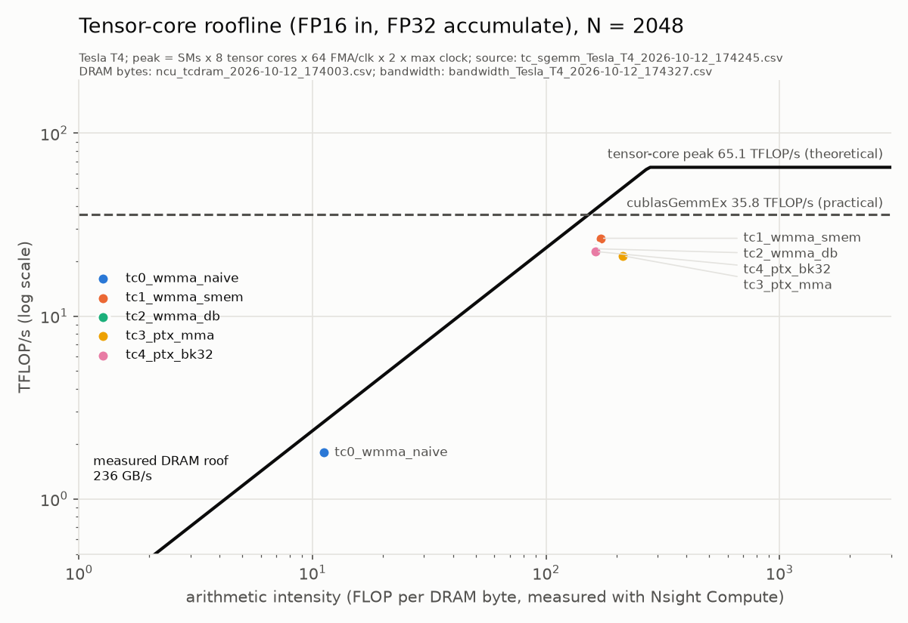

<!-- GENERATED by scripts/make_tables.py from docs/ANALYSIS.template.md and results/*.csv. Edit the template, not this file. -->

# cuda-sgemm: full analysis

The detailed write-up behind the [README](../README.md): every kernel, every counter, the
methodology and the side studies. All numbers are generated from [`results/`](../results/).

## Overview

Single-precision matrix multiply (C = A·B, row-major FP32) written in CUDA C++ and optimized
one idea at a time. Each step is measured on a Tesla T4, checked against cuBLAS, profiled with
Nsight Compute, and explained in terms of memory coalescing, data reuse, occupancy and
instruction mix. **Every number in this README is generated from the CSVs in
[`results/`](../results/)** by [`scripts/make_tables.py`](../scripts/make_tables.py); none is typed
by hand.

**Result.** The best FP32 kernel at N = 4096, `v9_autotuned`, reaches **90.8% of
cuBLAS** (2,915 GFLOP/s). At N = 256 the autotuned dispatcher `v9_autotuned` **beats
cuBLAS: 122.0%**. On a skinny transformer shape (128 × 4096 × 4096), split-K
lifts the result from 72.4% to
90.6%. Kernels are ranked by % of cuBLAS timed in the same thermal state, because raw
GFLOP/s on a power-capped T4 depends on how hot the GPU was at the time. At N = 2048 the best,
`v12_dispatch` (89.0%), is 55.8x the naive kernel. A
separate FP16 **tensor-core** track reaches **26.6 TFLOP/s** with
`tc1_wmma_smem` (68.2% of `cublasGemmEx`). All 90 of 90 kernel/size results pass the cuBLAS check
(largest normwise relative error 2.2e-06, tolerance 1e-04), including the non-multiple
sizes 1000 and 1023.

Main findings:

- **Register tiling is where the speed comes from.** Coalescing and shared-memory tiling
  (v1, v2) leave the kernel at 13.3% of cuBLAS. Making each thread compute a
  column of 8 outputs (v3) and then an 8×8 tile (v4) is what gets it to 61.3%: shared-memory loads per
  FMA drop from 1.250 to 0.062, and
  DRAM traffic falls to 4.4x the minimum.
- **Bank conflicts were the hidden limiter.** Nsight Compute found 2.0 shared-memory bank
  conflicts per shared load in v4–v6. Remapping which outputs each thread owns (v7) cut them
  2,172x, for a
  1.37x speedup: from 59.2%
  to 81.2% of cuBLAS at N = 4096. A small Python model of the bank
  rules predicted v6's conflict count exactly.
- **Two textbook optimizations did little here, and the counters show why.** The machine code
  shows the compiler had already turned v4's shared-memory reads into 128-bit loads, so
  hand-vectorizing (v5) changed nothing measurable. Two resident blocks per SM already overlap
  one block's loads with the other's math, so double buffering (v6) adds only
  1.03x at N = 4096.
- **Tile shape matters as much as any single optimization.** A sweep over 56 tile
  configurations of the same kernel finds `v14_64x128x8_8x8_b4_s0` at 90.8% of cuBLAS
  at N = 4096. At N = 256, small tiles beat cuBLAS outright (126.5% for
  `v7_64x32x8_4x4`): there the question is how many of the 40 SMs get any work at all.
- **The T4 is power-limited.** Under a dense FFMA load the SM clock drops far below its
  1590 MHz boost. To compare kernels fairly, the harness times cuBLAS interleaved with every
  kernel, and records the clock and power after each measurement.

## Results


**N = 4096** (M = N = K), GFLOP/s from the median of the timed runs:

| kernel | GFLOP/s | median ms | min – p90 ms | % cuBLAS | max rel err | check |
|---|---|---|---|---|---|---|
| cuBLAS | 3,630 | 37.87 | 25.81 – 37.92 | 100% (ref) | reference | REF |
| `v1_coalesced` | 510 | 269.56 | 239.83 – 271.66 | 11.1% | 0.0e+00 | PASS |
| `v2_smem_tiling` | 727 | 189.03 | 162.10 – 191.61 | 13.3% | 0.0e+00 | PASS |
| `v3_1d_blocktiling` | 1,327 | 103.60 | 69.06 – 105.44 | 28.8% | 0.0e+00 | PASS |
| `v4_2d_blocktiling` | 2,519 | 54.56 | 28.72 – 55.68 | 61.3% | 0.0e+00 | PASS |
| `v5_vectorized` | 2,569 | 53.50 | 29.84 – 55.44 | 57.3% | 0.0e+00 | PASS |
| `v6_double_buffered` | 2,579 | 53.29 | 29.22 – 54.07 | 59.2% | 0.0e+00 | PASS |
| `v7_conflict_free` | 3,084 | 44.56 | 21.47 – 44.76 | 81.2% | 0.0e+00 | PASS |
| `v8_warptiling` | 3,079 | 44.64 | 21.44 – 44.86 | 80.8% | 0.0e+00 | PASS |
| `v9_autotuned` | 2,915 | 47.14 | 21.54 – 47.85 | 90.8% | 0.0e+00 | PASS |
| `v11_splitk` | 2,875 | 47.81 | 21.59 – 48.77 | 89.7% | 0.0e+00 | PASS |
| `v12_dispatch` | 2,847 | 48.27 | 21.35 – 48.78 | 90.7% | 0.0e+00 | PASS |
| `v15_splitk_det` | 2,807 | 48.96 | 23.30 – 49.62 | 89.3% | 0.0e+00 | PASS |

Not run at this size: `v0_naive` (largest size run: 2048).

| GFLOP/s | N=256 | N=512 | N=1000 | N=1023 | N=1024 | N=2048 | N=4096 |
|---|---|---|---|---|---|---|---|
| cuBLAS | 713 | 2,485 | 5,556 | 5,713 | 5,912 | 6,770 | 3,630 |
| `v0_naive` | 24 | 33 | 110 | 181 | 60 | 62 |  |
| `v1_coalesced` | 329 | 639 | 680 | 674 | 640 | 544 | 510 |
| `v2_smem_tiling` | 398 | 809 | 890 | 938 | 899 | 786 | 727 |
| `v3_1d_blocktiling` | 497 | 1,548 | 2,114 | 2,059 | 2,085 | 1,581 | 1,327 |
| `v4_2d_blocktiling` | 217 | 1,572 | 3,439 | 3,397 | 3,441 | 2,881 | 2,519 |
| `v5_vectorized` | 218 | 1,709 | 3,415 | 3,091 | 3,591 | 2,921 | 2,569 |
| `v6_double_buffered` | 235 | 1,872 | 3,391 | 3,160 | 3,449 | 2,943 | 2,579 |
| `v7_conflict_free` | 298 | 2,174 | 4,799 | 4,267 | 4,631 | 3,498 | 3,084 |
| `v8_warptiling` | 302 | 2,256 | 4,563 | 3,924 | 4,718 | 3,355 | 3,079 |
| `v9_autotuned` | 869 | 3,425 | 4,684 | 4,432 | 4,745 | 3,467 | 2,915 |
| `v11_splitk` | 468 | 3,277 | 4,716 | 4,285 | 5,023 | 3,379 | 2,875 |
| `v12_dispatch` | 867 | 3,419 | 4,859 | 4,096 | 4,993 | 3,450 | 2,847 |
| `v15_splitk_det` | 475 | 3,641 | 4,606 | 3,960 | 4,832 | 3,412 | 2,807 |


### Roofline


- **Memory roof:** the **measured** DRAM bandwidth, 236 GB/s (74% of the
  320 GB/s spec), from [`src/bandwidth.cu`](../src/bandwidth.cu).
- **Compute roof:** the theoretical FP32 peak, 8,141 GFLOP/s (40 SMs × 64 FP32 lanes ×
  1590 MHz boost × 2 for FMA). It is labelled theoretical because the T4 can't hold that clock
  under load (see Methodology).
- **Practical ceiling:** cuBLAS.
- **Each kernel's arithmetic intensity is measured:** 2·N³ FLOPs divided by the DRAM bytes
  Nsight Compute counted for that kernel at N = 2048.
- The roofs meet at 34 FLOP/byte. The vertical line is the best possible intensity at
  this size, 341 FLOP/byte, which is A and B read once and C written once.

How to read it: v0–v2 sit far *below* the DRAM roof, so DRAM bandwidth isn't what limits them.
They are limited inside the SM, by how many load instructions the L1/shared-memory path can
serve. v4–v6 sit to the *right* of the ridge (76.8–82.5
FLOP/byte), so DRAM is no longer the limit at all. What remains is how fast the SM can issue
FMAs at the clock it can sustain.

Nsight Compute counters at N = 2048 (last of 2 profiled launches per kernel):

| kernel | DRAM MB moved | vs minimum | FLOP per DRAM byte | global sectors per load request | L1 hit | L2 hit | shared loads per FFMA (warp-level) | shared-load bank conflicts | shared-store bank conflicts | FFMA share of instructions |
|---|---|---|---|---|---|---|---|---|---|---|
| `v0_naive` | 2,258 | 44.9x | 7.6 | 16.5 | 99.2% | 76.5% | 0.000 | 0 | 0 | 22% |
| `v1_coalesced` | 1,688 | 33.5x | 10.2 | 2.5 | 95.0% | 49.7% | 0.000 | 0 | 0 | 22% |
| `v2_smem_tiling` | 1,662 | 33.0x | 10.3 | 4.0 | 0.0% | 48.5% | 1.250 | 0 | 0 | 33% |
| `v3_1d_blocktiling` | 672 | 13.3x | 25.6 | 4.0 | 0.1% | 60.6% | 0.375 | 0 | 0 | 53% |
| `v4_2d_blocktiling` | 224 | 4.4x | 76.8 | 3.9 | 17.9% | 80.5% | 0.062 | 33,554,432 | 0 | 83% |
| `v5_vectorized` | 209 | 4.2x | 82.1 | 15.8 | 17.9% | 80.4% | 0.062 | 33,554,432 | 2,097,152 | 88% |
| `v6_double_buffered` | 208 | 4.1x | 82.5 | 15.8 | 17.8% | 80.3% | 0.062 | 33,554,432 | 2,097,152 | 87% |
| `v7_conflict_free` | 184 | 3.7x | 93.2 | 15.8 | 0.1% | 79.7% | 0.062 | 15,451 | 136,685 | 87% |
| `v8_warptiling` | 185 | 3.7x | 93.0 | 15.8 | 1.4% | 79.7% | 0.062 | 24,068 | 69,121 | 87% |
| `v9_autotuned` | 296 | 5.9x | 58.0 | 15.8 | 0.1% | 74.3% | 0.062 | 28,915 | 503,128 | 84% |
| `v11_splitk` | 281 | 5.6x | 61.2 | 15.8 | 0.2% | 76.2% | 0.062 | 30,379 | 538,304 | 84% |
| `v12_dispatch` | 296 | 5.9x | 58.0 | 15.8 | 0.1% | 74.3% | 0.062 | 28,915 | 503,128 | 84% |
| `v15_splitk_det` | 281 | 5.6x | 61.2 | 15.8 | 0.2% | 76.2% | 0.062 | 29,486 | 539,323 | 84% |

How to read the counter columns:
- "Global sectors per load request" is 32-byte sectors per warp-wide load instruction. 4 is
  ideal for a 32-bit load and 16 for a 128-bit load (v5, v6).
- "Shared loads per FFMA" counts warp-level shared-memory load instructions per warp-level FMA
  instruction.

| kernel | threads/block | registers/thread | spill bytes/thread | static smem bytes | blocks/SM | warps/SM (theoretical occupancy) | achieved occupancy (ncu) |
|---|---|---|---|---|---|---|---|
| `v0_naive` | 1024 | 53 | 0 | 0 | 1 | 32/32 (100%) | 98% |
| `v1_coalesced` | 1024 | 53 | 0 | 0 | 1 | 32/32 (100%) | 99% |
| `v2_smem_tiling` | 1024 | 42 | 0 | 8,192 | 1 | 32/32 (100%) | 100% |
| `v3_1d_blocktiling` | 512 | 64 | 0 | 4,096 | 2 | 32/32 (100%) | 98% |
| `v4_2d_blocktiling` | 256 | 128 | 0 | 8,192 | 2 | 16/32 (50%) | 47% |
| `v5_vectorized` | 256 | 113 | 0 | 8,192 | 2 | 16/32 (50%) | 47% |
| `v6_double_buffered` | 256 | 127 | 0 | 16,384 | 2 | 16/32 (50%) | 47% |
| `v7_conflict_free` | 256 | 127 | 0 | 16,640 | 2 | 16/32 (50%) | 46% |
| `v8_warptiling` | 256 | 126 | 0 | 16,640 | 2 | 16/32 (50%) | 46% |
| `v9_autotuned` | 128 | 128 | 0 | 12,544 | 4 | 16/32 (50%) | 35% |
| `v11_splitk` | 128 | 128 | 0 | 12,544 | 4 | 16/32 (50%) | 45% |
| `v12_dispatch` | 128 | 128 | 0 | 12,544 | 4 | 16/32 (50%) | 35% |
| `v15_splitk_det` | 128 | 128 | 0 | 12,544 | 4 | 16/32 (50%) | 45% |

## The kernels, one idea at a time

Each kernel file starts with a comment block: what changed from the previous version, why it
should be faster, and what limits it now. Below, the same story with the measurements.
Comparisons between kernels use the **throttle-normalised speedup**, the ratio of their
"% of cuBLAS". It cancels out clock changes between the two measurements.

### v0: naive, one thread per output ([`v0_naive.cu`](../src/kernels/v0_naive.cu))

Thread (x, y) of a 32×32 block computes C[row][col], with **row taken from `threadIdx.x`**.
A warp is 32 consecutive `threadIdx.x`, so one warp covers 32 *rows* and one column:
- Its loads of `A[row][k]` hit 32 addresses K floats apart: 32 separate 32-byte sectors for 128
  useful bytes. That's uncoalesced; ncu counts 16.5 sectors per request.
- Its loads of `B[k][col]` are a single address for the whole warp, a broadcast.
- Its stores to C are strided like A.

Measured: 62 GFLOP/s at N = 2048, 0.9% of cuBLAS.
It moves 2,258 MB through DRAM, 44.9x the minimum.

**A side finding: v0 is 3.0x faster at N = 1023 than at N = 1024.** v0 reaches 181
GFLOP/s at N = 1023 but only 60 at N = 1024, and this reproduced in every
run. The obvious explanation would be extra cache misses from the power-of-two stride. The
counters rule that out: DRAM traffic, L1 and L2 hit rates and sector counts are all
essentially the same at both sizes, yet the kernel takes far longer at 1024.

| v0_naive | N = 1023 | N = 1024 |
|---|---|---|
| kernel time (ncu, locked clocks) | 29.2 ms | 96.2 ms |
| DRAM read | 221 MB | 201 MB |
| L1 hit rate | 99.1% | 99.2% |
| L2 hit rate | 83.2% | 82.8% |
| global load sectors | 1,104.1 M | 1,107.3 M |
| L1 tag-stage set accesses | 1,104.1 M | 1,107.3 M |
| L1 tag-stage set conflicts | 262.3 M | 234.9 M |

So the same accesses, hitting in L1 just as often, are served more slowly. My first hypothesis
was L1 cache *set* conflicts. With a 4 KB stride, the 32 addresses of one warp request map to
the same set, and an odd stride would spread them out. I measured it, and **the data rejects
it**: N = 1023 has *more* L1 set conflicts (262.3 M)
than N = 1024 (234.9 M), yet runs
faster. The cause is still open. The next candidates are contention for L2 slices or DRAM
channels: a power-of-two stride sends every request of a warp to the same address-interleaved
partition. None of the counters collected here isolates that.

### v1: coalesced ([`v1_coalesced.cu`](../src/kernels/v1_coalesced.cu))

**One change:** `threadIdx.x` now picks the *column*. Same loop, same FLOPs, same number of
loads. A warp now covers one row and 32 adjacent columns:
- `B[k][col]` is 32 consecutive floats, one 128-byte access.
- `A[row][k]` becomes the broadcast.
- The C stores are contiguous.

Measured: **8.8x faster than v0** at N = 2048
(544 GFLOP/s). Sectors per request drop from 16.5
to 2.5.

New limit: every FMA still needs two global load instructions. They mostly hit in L1
(95.0%), but the load/store pipeline, not the FMA units, sets the pace.

### v2: shared-memory tiling ([`v2_smem_tiling.cu`](../src/kernels/v2_smem_tiling.cu))

The block copies a 32×32 tile of A and of B into shared memory, an on-chip scratchpad the
program manages explicitly (64 KB per SM on a T4). Each thread then does its 32 multiply-adds
from there. Each element is fetched from global memory once per block instead of once per
thread, so global load instructions drop 32×.

There are two `__syncthreads()` per tile:
1. The first, so no thread reads the tile before it's fully written.
2. The second, so no thread overwrites it with the next tile while others are still reading.

Edge tiles are zero-padded, so sizes 1000 and 1023 need no special case.

Measured: **1.20x vs v1** at N = 4096
(727 GFLOP/s, 13.3% of cuBLAS).

What the counters say:
- **DRAM traffic barely changed** (1,688 → 1,662 MB).
  v1 was already getting its reuse from L1. The gain is in *instructions*: global loads became
  shared loads. ncu counts 1.250 shared loads per FMA, not the naive
  2, because the compiler reads each thread's A row with 128-bit loads (4 values at once).
- The new limit is still about 1 shared load per FMA. On top of that, 1024 threads per block
  means 1 block per SM, so at every `__syncthreads()` the whole SM waits
  for its slowest warp.

### v3: 1D register tiling ([`v3_1d_blocktiling.cu`](../src/kernels/v3_1d_blocktiling.cu))

Each thread now computes **8 outputs in a column**, keeping 8 accumulators in registers. Per k
it loads one B value and reuses it for 8 FMAs. The block tile is 64×64, 8 deep, with 512
threads, so 2 blocks fit on an SM. Per tile phase a block loads 1024
floats for 32,768 FMAs, twice v2's reuse.

Measured: **2.16x vs v2** at N = 4096
(1,327 GFLOP/s).
- Shared loads per FMA fall to 0.375.
- DRAM traffic falls to 672 MB, thanks to the larger tile.
- 64 registers per thread, 0 bytes spilled.

### v4: 2D register tiling ([`v4_2d_blocktiling.cu`](../src/kernels/v4_2d_blocktiling.cu))

Each thread computes an **8×8 tile**. Per k it loads 8 A values and 8 B values into registers
and does their 64-FMA outer product. The block tile is 128×128 with 256 threads, and each thread
holds 64 accumulators.

`__launch_bounds__(256, 2)` makes the compiler fit two blocks per SM, which caps it at 128
registers per thread. It uses 128, with 0
bytes spilled. That leaves 50% theoretical occupancy
(47% achieved): fewer warps than v3, but each has 64 independent
FMAs per k step, so latency is hidden by instruction-level parallelism instead of by more
threads.

Measured: **2.13x vs v3**,
2,519 GFLOP/s, 61.3% of cuBLAS at N = 4096.
- Shared loads per FMA: 0.062, which is 4 per 64 FMAs. That means
  the compiler already uses 128-bit shared loads.
- DRAM traffic is 224 MB (76.8 FLOP/byte, past the
  roofline ridge).
- ncu reports 33,554,432 shared-memory bank conflicts at N = 2048.

### v5: vectorized loads ([`v5_vectorized.cu`](../src/kernels/v5_vectorized.cu))

Same tiling as v4. Global loads become 128-bit `float4`, and the A tile is stored **transposed**
in shared memory, so a thread's 8 A values for one k are contiguous. When a row can't be read as
aligned `float4` (K or N not a multiple of 4, as at 1023) or a chunk crosses the matrix edge, the
loader falls back to guarded scalar loads.

Measured: **0.93x vs v4** at N = 4096 and
1.01x at N = 2048, so no real change.

The counters explain why:
- Shared loads per FMA are identical (0.062 vs
  0.062). The compiler had already vectorized v4's shared reads.
- The bank-conflict count is unchanged (33,554,432).
- Global loads were never the bottleneck. Per 8-deep tile, a thread does 512 FMAs and only 8
  global loads, so cutting those 8 to 2 saves almost nothing.
- At N = 1023 v5 is slower than v4 (53.4% vs 59.8%
  of cuBLAS): every load takes the guarded scalar path, which costs more than v4's plain loads.

This is a negative result, kept on purpose: measure before assuming an optimization helps.

### v6: double buffering ([`v6_double_buffered.cu`](../src/kernels/v6_double_buffered.cu))

Same tiles and loads as v5, with two shared-memory buffers. Each thread issues its global loads
for tile t+1 *before* computing tile t, and stores them into the other buffer afterwards, with
one `__syncthreads()` per tile instead of two. The cost is 16 KB of shared memory per block
(2 blocks still fit) and 127 registers, still within the 128 cap and
with 0 bytes spilled.

Measured: **1.03x vs v5** at N = 4096
(2,579 GFLOP/s, 59.2% of cuBLAS) and
1.01x at N = 2048. A small gain: with 2 blocks
per SM, the hardware was already overlapping one block's loads with the other's math.

### v7: conflict-free shared memory ([`v7_conflict_free.cu`](../src/kernels/v7_conflict_free.cu))

**Diagnosis.** In v4–v6, every shared-load instruction had exactly two bank conflicts. Shared
memory has 32 banks of 4 bytes, and a 128-bit load is served in 4 phases of 8 threads. In v6,
the 8 threads of a phase read B at columns 0, 8, 16, …, 56. Those 16-byte slots are 32 bytes
apart, so threads 0 and 4, 1 and 5, and so on collide on the same banks.

**The fix changes only which outputs a thread owns.** Each thread now holds four 4×4 pieces 64
rows/columns apart, instead of one 8×8 square. A phase then reads columns 0, 4, …, 28: 128
contiguous bytes, which is conflict-free. The transposed A tile is padded from 128 to 132 floats
per row, so its stores no longer collide either. The output strips are now contiguous, so C is
written with 128-bit stores.

Measured: **1.37x vs v6** at N = 4096
(3,084 GFLOP/s, 81.2% of cuBLAS) and
1.31x at N = 2048. Bank conflicts at N = 2048:
15,451 on loads and 136,685 on stores,
against 33,554,432 and 2,097,152 for v6.
The shared-load conflict count fell 2,172x, and
that alone bought the largest step since v4: the FFMA share of instructions, shared loads per
FMA and DRAM traffic are essentially unchanged from v6 (table above). What changed is that each
shared load now takes one pass instead of three.

**The conflict counts were predicted before the run.**
[`scripts/bank_model.py`](../scripts/bank_model.py) replays each kernel's shared-memory addresses
for one warp and applies the bank rules.
- For v5 and v6 it reproduces Nsight Compute's counts exactly.
- For v7 and v8 it predicted zero. ncu measures a small residual of v6's count
  that the model doesn't explain (0.05% for v7, 0.07% for v8), so it is reported here, not hidden.

Shared-memory bank conflicts at N = 2048: the analytical model in [`scripts/bank_model.py`](../scripts/bank_model.py) (lane addresses from the kernel source + the 32-bank / 8-lanes-per-128-bit-phase rule) next to Nsight Compute's counters:

| kernel | model: load | ncu: load | model: store | ncu: store |
|---|---|---|---|---|
| `v5_vectorized` | 33,554,432 | 33,554,432 | 2,097,152 | 2,097,152 |
| `v6_double_buffered` | 33,554,432 | 33,554,432 | 2,097,152 | 2,097,152 |
| `v7_conflict_free` | 0 | 15,451 | 0 | 136,685 |
| `v8_warptiling` | 0 | 24,068 | 0 | 69,121 |

### v8: warp tiling ([`v8_warptiling.cu`](../src/kernels/v8_warptiling.cu))

v8 adds a level between the block and the thread, the way CUTLASS and cuBLAS organise SGEMM:
block tile → **warp tile** → thread tile.
- The 8 warps of a block each own a contiguous 64×32 piece of the 128×128 tile.
- Inside it, each thread computes 2×2 pieces of 4×4.

Per k step a thread loads exactly what it did in v7 (8 A + 8 B values). But the warp as a whole
asks shared memory for **96 distinct floats instead of 144**: more lanes share each value. That
cuts shared-memory bandwidth per FMA by a third. Reads stay conflict-free (see the model table
above).

Measured: **1.00x vs v7** at N = 4096
(3,079 GFLOP/s, 80.8% of cuBLAS) and
0.98x at N = 2048. 126 registers
per thread, 0 bytes spilled.
Warp tiling bought nothing measurable on top of v7. That's consistent with v7's counters: once
the conflicts were gone, shared-memory bandwidth was no longer the limit. So asking for fewer
distinct floats per warp (96 instead of 144) relieved a resource that wasn't the bottleneck. On
tensor-core GPUs warp tiling matters more, because the warp tile is the unit that feeds `mma`
instructions.

### Tuning study: one kernel, many tile shapes

The v7 and v8 kernels are C++ templates over their tile sizes, so `./bench --tune` can run 18
configurations (56 in total) of the same code at every size, all verified against cuBLAS:
- **v7:** 12 block/thread tile shapes;
- **v8:** 6 warp-tile shapes.

The number to watch is **waves**. With 40 SMs × (blocks per SM) slots, a grid of B blocks
runs in B / slots waves. A fractional last wave leaves SMs idle, and fewer than one wave means
SMs are idle the whole time.
- At N = 256 a 128×128 tile gives 0.1 waves.
- A 32×32 tile gives 0.1 waves.

% of paired cuBLAS for each tile configuration (v7_<BM>x<BN>x<BK>_<TM>x<TN>: block tile, then thread tile; v8_<BM>x<BN>x<BK>_w<WM>x<WN>_<WMITER>x<WNITER>: block tile, warp tile, pieces per thread), from `results/tune_sgemm_Tesla_T4_2026-10-12_173456.csv`:

| config | threads | registers | blocks/SM | N=256 | N=512 | N=1000 | N=1023 | N=1024 | N=2048 | N=4096 |
|---|---|---|---|---|---|---|---|---|---|---|
| `v7_128x128x8_8x8` | 256 | 127 | 2 | 54% | 53% | 74% | 70% | 79% | 83% | 82% |
| `v7_128x128x16_8x8` | 256 | 128 | 1 | 45% | 55% | 68% | 73% | 74% | 75% | 70% |
| `v7_128x64x8_8x8` | 128 | 133 | 3 | 68% | 74% | 72% | 62% | 75% | 82% | 79% |
| `v7_64x128x8_8x8` | 128 | 137 | 3 | 69% | 81% | 73% | 68% | 80% | 87% | 88% |
| `v7_128x64x16_8x8` | 128 | 157 | 2 | 80% | 76% | 68% | 68% | 74% | 80% | 77% |
| `v7_64x64x8_8x8` | 64 | 139 | 6 | 69% | 49% | 72% | 58% | 76% | 78% | 81% |
| `v7_64x64x16_8x8` | 64 | 173 | 3 | 67% | 48% | 67% | 68% | 69% | 69% | 70% |
| `v7_64x64x8_4x4` | 256 | 69 | 3 | 112% | 63% | 55% | 47% | 57% | 54% | 50% |
| `v7_64x64x16_4x4` | 256 | 69 | 3 | 121% | 63% | 56% | 51% | 59% | 55% | 52% |
| `v7_128x128x8_4x4` | 1024 | 63 | 1 | 36% | 41% | 52% | 48% | 54% | 53% | 49% |
| `v7_64x32x8_4x4` | 128 | 71 | 7 | 127% | 55% | 52% | 41% | 52% | 44% | 43% |
| `v7_32x32x8_4x4` | 64 | 71 | 14 | 115% | 58% | 48% | 40% | 47% | 42% | 42% |
| `v8_128x128x8_w64x32_2x2` | 256 | 126 | 2 | 46% | 54% | 78% | 70% | 80% | 82% | 82% |
| `v8_128x128x8_w32x64_2x2` | 256 | 126 | 2 | 52% | 53% | 77% | 72% | 79% | 82% | 82% |
| `v8_128x128x16_w64x32_2x2` | 256 | 128 | 1 | 46% | 46% | 58% | 57% | 64% | 65% | 61% |
| `v8_128x64x8_w64x32_2x2` | 128 | 137 | 3 | 76% | 79% | 75% | 64% | 76% | 83% | 80% |
| `v8_64x64x8_w32x32_1x2` | 128 | 89 | 5 | 117% | 72% | 63% | 53% | 65% | 60% | 57% |
| `v8_64x64x16_w32x32_1x2` | 128 | 103 | 3 | 124% | 75% | 63% | 58% | 67% | 63% | 60% |
| `v10_64x128x8_8x8_b2_s0` | 128 | 137 | 3 | 73% | 81% | 77% | 70% | 79% | 88% | 88% |
| `v10_64x128x8_8x8_b2_s8` | 128 | 143 | 3 | 75% | 76% | 78% | 70% | 79% | 87% | 89% |
| `v10_64x128x8_8x8_b4_s0` | 128 | 128 | 4 | 76% | 74% | 78% | 73% | 84% | 89% | 91% |
| `v10_64x128x8_8x8_b4_s8` | 128 | 128 | 4 | 74% | 78% | 78% | 73% | 81% | 89% | 87% |
| `v10_128x64x8_8x8_b2_s8` | 128 | 141 | 3 | 73% | 73% | 76% | 64% | 76% | 82% | 78% |
| `v10_128x64x8_8x8_b4_s0` | 128 | 127 | 4 | 78% | 74% | 76% | 68% | 76% | 84% | 80% |
| `v10_64x128x8_8x4_b2_s0` | 256 | 86 | 2 | 82% | 78% | 70% | 59% | 71% | 76% | 72% |
| `v10_64x128x8_4x8_b2_s0` | 256 | 85 | 2 | 77% | 69% | 61% | 52% | 62% | 66% | 60% |
| `v10_64x128x8_4x8_b2_s8` | 256 | 89 | 2 | 77% | 74% | 61% | 52% | 62% | 65% | 58% |
| `v10_128x128x8_8x8_b2_s8` | 256 | 128 | 2 | 46% | 48% | 77% | 72% | 78% | 80% | 78% |
| `v10_64x64x8_8x8_b4_s0` | 64 | 139 | 6 | 73% | 48% | 75% | 61% | 79% | 79% | 81% |
| `v10_64x64x8_8x8_b6_s8` | 64 | 156 | 6 | 71% | 48% | 75% | 61% | 81% | 78% | 82% |
| `v10_32x128x8_4x8_b4_s0` | 128 | 95 | 5 | 108% | 66% | 63% | 50% | 68% | 60% | 61% |
| `v10_128x32x8_8x4_b4_s0` | 128 | 91 | 5 | 109% | 63% | 66% | 50% | 65% | 59% | 57% |
| `v10_64x128x4_8x8_b4_s8` | 128 | 126 | 4 | 70% | 71% | 71% | 63% | 78% | 81% | 75% |
| `v10_64x128x8_8x8_b5_s0` | 128 | 96 | 5 | 46% | 49% | 62% | 62% | 65% | 75% | 78% |
| `v10_64x128x8_8x8_b4_s4` | 128 | 128 | 4 | 74% | 78% | 78% | 75% | 82% | 89% | 85% |
| `v10_64x128x8_8x8_b4_s16` | 128 | 128 | 4 | 74% | 77% | 77% | 74% | 84% | 89% | 90% |
| `v10_96x128x8_8x8_b3_s0` | 192 | 96 | 3 | 31% | 33% | 48% | 49% | 51% | 63% | 64% |
| `v10_64x192x8_8x8_b3_s0` | 192 | 96 | 3 | 35% | 36% | 52% | 54% | 56% | 67% | 69% |
| `v10_64x256x8_8x8_b2_s0` | 256 | 128 | 2 | 46% | 48% | 74% | 75% | 82% | 82% | 86% |
| `v10_128x64x8_8x8_b4_s8` | 128 | 128 | 4 | 58% | 61% | 69% | 62% | 71% | 77% | 74% |
| `v13_64x128x8_w32x64_2x2_b4` | 128 | 128 | 4 | 62% | 66% | 70% | 66% | 74% | 84% | 85% |
| `v13_64x128x8_w64x32_2x2_b4` | 128 | 128 | 4 | 62% | 65% | 69% | 66% | 73% | 84% | 85% |
| `v13_64x128x8_w32x64_1x4_b4` | 128 | 128 | 4 | 73% | 72% | 66% | 60% | 73% | 73% | 67% |
| `v13_64x128x8_w32x64_2x2_b3` | 128 | 139 | 3 | 76% | 78% | 77% | 70% | 81% | 89% | 89% |
| `v13_64x128x8_w32x64_2x2_b2` | 128 | 139 | 3 | 76% | 83% | 78% | 69% | 81% | 90% | 90% |
| `v13_128x64x8_w64x32_2x2_b4` | 128 | 128 | 4 | 76% | 76% | 75% | 66% | 77% | 83% | 80% |
| `v13_128x64x8_w32x64_2x2_b4` | 128 | 128 | 4 | 73% | 75% | 75% | 67% | 76% | 83% | 81% |
| `v13_128x128x8_w64x32_2x2_b2` | 256 | 126 | 2 | 47% | 50% | 78% | 69% | 79% | 82% | 82% |
| `v13_64x64x8_w32x32_1x2_b6` | 128 | 80 | 6 | 92% | 58% | 55% | 47% | 56% | 54% | 52% |
| `v13_64x64x8_w32x32_2x1_b6` | 128 | 80 | 6 | 79% | 61% | 59% | 53% | 61% | 60% | 59% |
| `v14_64x128x8_8x8_b2_s0` | 128 | 134 | 3 | 65% | 77% | 77% | 69% | 81% | 88% | 90% |
| `v14_64x128x8_8x8_b3_s0` | 128 | 134 | 3 | 65% | 76% | 77% | 70% | 81% | 88% | 89% |
| `v14_64x128x8_8x8_b4_s0` | 128 | 128 | 4 | 66% | 76% | 77% | 73% | 80% | 89% | 91% |
| `v14_128x64x8_8x8_b3_s0` | 128 | 129 | 3 | 75% | 79% | 75% | 65% | 79% | 82% | 79% |
| `v14_128x64x8_8x8_b4_s0` | 128 | 126 | 4 | 72% | 76% | 75% | 68% | 77% | 83% | 80% |
| `v14_128x128x8_8x8_b2_s0` | 256 | 125 | 2 | 45% | 49% | 76% | 73% | 79% | 82% | 81% |

Best configuration per size: N = 256: `v7_64x32x8_4x4` (127%, 0.1 waves); N = 512: `v13_64x128x8_w32x64_2x2_b2` (83%, 0.3 waves); N = 1000: `v8_128x128x8_w64x32_2x2` (78%, 0.8 waves); N = 1023: `v10_64x256x8_8x8_b2_s0` (75%, 0.8 waves); N = 1024: `v10_64x128x8_8x8_b4_s16` (84%, 0.8 waves); N = 2048: `v13_64x128x8_w32x64_2x2_b2` (90%, 4.3 waves); N = 4096: `v14_64x128x8_8x8_b4_s0` (91%, 12.8 waves).

What the sweep shows:
- **Large sizes:** `v7_64x128x8_8x8` beats the default 128×128 tile
  (87.6% vs 81.8% at N = 4096). With
  128 threads per block, 3 blocks fit on an SM instead of 2.
- **Deeper K tiles (BK = 16) are consistently worse.** They double shared memory per block, so
  fewer blocks fit on an SM, and that outweighs halving the barriers.
- **Small sizes:** what matters is filling the SMs. At N = 256 the default tile makes
  0.1 waves (most SMs idle), while a 32×32 tile makes
  0.1. The small-tile configs are the ones that beat cuBLAS there.
- **Caveat:** picking the best of 18 noisy measurements biases the winner's number upward
  (the "winner's curse"). The per-size winners should be re-measured on their own before
  quoting them as one kernel's result.

### v10: occupancy by launch bounds, and threadblock swizzle

The sweep above says the best shape wins on **occupancy**: with 128-thread blocks, 3 fit on an SM
instead of 2. [`v10_tuned.cu`](../src/kernels/v10_tuned.cu) is v7's kernel (generated from it) with
two more template knobs, swept in the same study:
- **`MINB`**, the minimum-blocks-per-SM hint of `__launch_bounds__`. It caps registers per
  thread at 65536 / (MINB × threads).
- **`SWZ`**, a threadblock swizzle. The grid is walked in groups of SWZ block-columns, so blocks
  resident at the same time share B column-panels in L2.

Results for the 64×128 tile at N = 4096:

| config | registers | blocks/SM | % of cuBLAS |
|---|---|---|---|
| `v10_64x128x8_8x8_b2_s0` (= v7's best shape) | 137 | 3 | 88.1% |
| `v10_64x128x8_8x8_b4_s0` (128-register cap) | 128 | 4 | 90.6% |
| `v10_64x128x8_8x8_b2_s8` (swizzle only) | 143 | 3 | 89.1% |
| `v10_64x128x8_8x8_b4_s4` (cap + swizzle 4) | 128 | 4 | 85.3% |
| `v10_64x128x8_8x8_b4_s8` (cap + swizzle 8) | 128 | 4 | 87.2% |
| `v10_64x128x8_8x8_b4_s16` (cap + swizzle 16) | 128 | 4 | 89.9% |

- **Capping registers worked.** At 128 registers per thread the compiler still didn't spill
  (0 bytes of local memory), and a
  fourth block per SM gives more warps to hide shared-load and barrier latency.
- **The swizzle results scatter in both directions** across group widths, by about as much as
  the same configuration moves between tuning runs. Within this noise there's no reliable swizzle
  effect. That's consistent with the roofline: these kernels sit far to the right of the ridge,
  so L2 and DRAM traffic aren't what limits them.
- **Pushing further spilled.** A 102-register cap (MINB = 5) and the 96×128 and 64×192 shapes
  spill (48,
  64 and
  48 bytes per thread) and lose.

### v13 and v14: Boehm's last two ideas, on top of the occupancy finding

Two techniques from the end of Simon Boehm's worklog were added as further knobs in the same
tuning study. Each is generated from an earlier kernel, so only one idea changes.
- **v13, warp tiling with the occupancy knob**
  ([`v13_warptile_occ.cu`](../src/kernels/v13_warptile_occ.cu)): v8's warp-tiled kernel with
  `MINB` as a template parameter, on the 64×128 and 128×64 blocks that won the v10 sweep. Warp
  tiling was Boehm's largest late gain (his kernel 10). v8 had tried it only with 128×128 blocks
  at 2 blocks per SM.
- **v14, register prefetch** ([`v14_prefetch.cu`](../src/kernels/v14_prefetch.cu)): v10 with the
  shared→register fragments double-buffered. While the FMAs for step k run, the A and B values
  for step k+1 are already being loaded. This is the "prefetch the innermost dimension" that
  Boehm lists as remaining work. It costs 16 more registers per thread.

Averages over every tuning run that measured them (the same average the dispatch uses):

| config | N = 1024 | N = 2048 | N = 4096 | runs |
|---|---|---|---|---|
| `v10_64x128x8_8x8_b4_s0` (no prefetch) | 80.8% | 89.0% | 90.4% | 7 |
| `v14_64x128x8_8x8_b4_s0` (prefetch) | 80.3% | 89.2% | **91.2%** | 2 |
| `v14_64x128x8_8x8_b3_s0` (prefetch, 3 blocks/SM) | 80.8% | **90.3%** | 89.6% | 2 |
| `v13_64x128x8_w32x64_2x2_b2` (warp tiling) | **83.6%** | 88.6% | 89.5% | 2 |

- **Prefetch wins at the large sizes.** With the 128-register cap, the extra registers still
  fit without spilling
  (0 bytes of local memory), so the
  overlap of shared loads with FMAs is close to free.
- **Warp tiling wins at N = 1024.** With the right block shape it finally pays off on the T4.
- The robust dispatch table (averaged over 10 tuning runs, `results/tune_sgemm_*.csv`) uses v14 for the large sizes and v13 at 1024.
  That's how the final kernel reaches the headline number.

### What the compiler actually emitted (SASS)

"The compiler already vectorised v4's shared loads" is checked in the machine code: `cuobjdump
-sass` on the built binary, counting instructions per kernel:

Static instruction counts in each kernel's compiled machine code (SASS, from `cuobjdump -sass`). Static means instructions present in the binary, not executed; the fully unrolled inner loop dominates, so the last column tracks the inner loop's shared-load to FMA ratio. `.128` = 128-bit (vector) access.

| kernel | total | FFMA | LDS | LDS.128 | LDG | LDG.128 | STS | STS.128 | STG | STG.128 | BAR | LDS per FFMA (static) |
|---|---|---|---|---|---|---|---|---|---|---|---|---|
| `v0_naive` | 206 | 29 | 0 | 0 | 58 | 0 | 0 | 0 | 1 | 0 | 0 | 0.000 |
| `v1_coalesced` | 206 | 29 | 0 | 0 | 58 | 0 | 0 | 0 | 1 | 0 | 0 | 0.000 |
| `v2_smem_tiling` | 129 | 32 | 40 | 8 | 2 | 0 | 2 | 0 | 1 | 0 | 2 | 1.250 |
| `v3_1d_blocktiling` | 210 | 64 | 24 | 16 | 2 | 0 | 2 | 0 | 8 | 0 | 2 | 0.375 |
| `v4_2d_blocktiling` | 914 | 512 | 32 | 32 | 8 | 0 | 8 | 0 | 64 | 0 | 2 | 0.062 |
| `v5_vectorized` | 912 | 512 | 32 | 32 | 10 | 2 | 5 | 1 | 64 | 0 | 2 | 0.062 |
| `v6_double_buffered` | 976 | 512 | 32 | 32 | 20 | 4 | 10 | 2 | 64 | 0 | 2 | 0.062 |
| `v7_conflict_free` | 1,339 | 512 | 32 | 32 | 20 | 4 | 10 | 2 | 128 | 16 | 2 | 0.062 |
| `v8_warptiling` | 1,345 | 512 | 32 | 32 | 20 | 4 | 10 | 2 | 128 | 16 | 2 | 0.062 |
| `v11_splitk` | 1,809 | 512 | 32 | 32 | 42 | 6 | 12 | 4 | 80 | 16 | 2 | 0.062 |
| `v15_splitk_det` | 1,508 | 512 | 32 | 32 | 42 | 6 | 12 | 4 | 128 | 16 | 2 | 0.062 |

Three claims made earlier are confirmed in the machine code:
- **v4** already reads shared memory only with `LDS.128`, though its source uses scalar reads.
  That is why v5 gained nothing.
- **v5** is where `LDG.128` (128-bit global loads) first appears.
- **v7** writes C with `STG.128`.

v2's static shared-loads-per-FMA ratio (40 loads for
32 FMAs) matches the dynamic ratio ncu measured
(1.250).

### v9: autotuned dispatch ([`v9_autotuned.cu`](../src/kernels/v9_autotuned.cu))

v9 adds no new device code. [`scripts/gen_dispatch.py`](../scripts/gen_dispatch.py) reads the tuning
CSV (averaged over 10 tuning runs, `results/tune_sgemm_*.csv`) and writes a table: for each tuned size, the configuration with the best
% of cuBLAS among those that passed everywhere. At run time v9 picks the entry closest to the
problem size. The choices it makes:
- `v7_64x32x8_4x4` at N = 256;
- `v13_64x128x8_w32x64_2x2_b2` at N = 1024;
- `v14_64x128x8_8x8_b4_s0` at N = 4096.

Because the best of many noisy measurements is biased upward, v9 is **measured again in its own
benchmark run**, and only that number is reported:
- **90.8% of cuBLAS at N = 4096**, 1.12x
  vs v7;
- **122.0% at N = 256**, where it beats cuBLAS (869 vs
  713 GFLOP/s).
**Winner's-curse check.** At N = 4096 the independent measurement
(90.8%) matches what the tuning run recorded for that configuration
(91.2%). At N = 256 it comes in lower (122.0% vs
127.3%): small kernels take tens of microseconds, so their measurements are
noisier, and picking the best of 18 of them inflates the winner the most. v9 still beats cuBLAS
there. At N = 1024 the dispatched configuration (80.7%) is slightly below the
default v7 (83.1%) in this run, for the same reason.

### Tensor-core track (separate precision)

The FP32 series above multiplies FP32 inputs on the FP32 units. A T4 also has **tensor cores**:
8 per SM, each doing a 4×4×4 FP16 matrix multiply-accumulate per clock. That's 8× the SM's FP32
FMA rate. They're programmed through WMMA (`<mma.h>`): a warp loads 16×16 "fragments" of A and B
and issues `mma_sync`.

This is a different numerical problem: A and B are rounded to FP16, accumulation stays FP32. So
this track is **verified and timed against `cublasGemmEx` with the same FP16 inputs**, never
against SGEMM, and it never appears in the FP32 tables. Two kernels:
- [`tc0_wmma_naive.cu`](../src/kernels/tc0_wmma_naive.cu): one warp per 16×16 output tile, with
  fragments loaded straight from global memory. This is v1's problem again: no reuse.
- [`tc1_wmma_smem.cu`](../src/kernels/tc1_wmma_smem.cu): a 128×128 block tile staged in shared
  memory, with rows padded 8 halves to spread banks. Each of 8 warps owns 64×32 = 4×2 fragments.

TFLOP/s (and % of `cublasGemmEx`, timed interleaved), from `results/tc_sgemm_Tesla_T4_2026-10-12_174245.csv`. Every kernel is checked against `cublasGemmEx` with the same FP16 inputs (largest observed error 1.0e-06).

| kernel | N=256 | N=512 | N=1024 | N=2048 | N=4096 |
|---|---|---|---|---|---|
| `cublasGemmEx` (FP16 in, FP32 out) | 2.0 | 11.2 | 28.7 | 38.5 | 23.8 |
| `tc0_wmma_naive` | 1.8 (97%) | 2.9 (27%) | 3.2 (11%) | 1.8 (8%) | 1.2 (7%) |
| `tc1_wmma_smem` | 1.6 (83%) | 7.7 (71%) | 20.6 (70%) | 26.6 (68%) | 11.3 (63%) |
| `tc2_wmma_db` | 1.9 (93%) | 9.4 (86%) | 19.8 (68%) | 23.3 (64%) | 10.9 (59%) |
| `tc3_ptx_mma` | 1.7 (87%) | 8.7 (80%) | 20.6 (71%) | 21.4 (60%) | 11.4 (60%) |
| `tc4_ptx_bk32` | 1.6 (80%) | 7.5 (69%) | 19.7 (68%) | 22.6 (63%) | 11.2 (60%) |

Precision cost of FP16 inputs (not a kernel error): normwise relative difference between the FP16-input result and FP32 SGEMM on the same data: N = 256: 2.8e-04; N = 512: 2.7e-04; N = 1024: 2.8e-04; N = 2048: 2.8e-04; N = 4096: 2.6e-04.



The tensor-core kernels on their own roofline: the same measured DRAM roof, the theoretical
tensor-core peak (SMs × 8 tensor cores × 64 FMA per clock × 2 × max clock) and `cublasGemmEx` as
the practical ceiling. tc0 sits far down the memory slope. The shared-memory kernels sit close
together just left of the ridge, below both roofs and below `cublasGemmEx`.

- [`tc2_wmma_db.cu`](../src/kernels/tc2_wmma_db.cu): tc1 plus double buffering. The next K tile's
  global loads are in flight while the tensor cores work, with two shared buffers and one
  barrier per tile. The K tile is cut from 32 to 16 so both buffers still let 2 blocks share an
  SM.

At N = 4096, `tc1` runs **9.6x faster than `tc0`** and
3.7x the throughput of the fastest FP32 kernel, at
63.0% of `cublasGemmEx`. `tc2` vs `tc1`:
0.9x at N = 2048 (64.1% of
`cublasGemmEx`), with the tensor pipe busy 51.5% of the time.
**Double buffering only paid off at small sizes.**
- At N = 512, tc2 beats tc1: 86.0% vs 71.0% of
  `cublasGemmEx`.
- From N = 1024 up it's slower: 64.1% vs 68.2% at
  N = 2048. To fit two buffers and still keep 2 blocks per SM, tc2 halves the K tile. That
  halves the MMAs between barriers and doubles the load rounds per unit of K, and once the grid
  fills the GPU this costs more than the overlap saves.
- Tensor pipe busy: 51.5% for tc2 vs 54.6% for tc1. This is
  another measured negative result, kept for the same reason as v5.

- [`tc3_ptx_mma.cu`](../src/kernels/tc3_ptx_mma.cu): the same tiling as tc2, written without WMMA.
  It uses the PTX instructions WMMA hides: `ldmatrix.sync…x4` (one instruction loads four 8×8
  FP16 matrices into the exact register layout the MMA expects; `.trans` handles B) and
  `mma.sync.aligned.m16n8k8`, Turing's native tensor-core instruction. Its fragment index math
  was checked before the GPU run against a CPU emulation of both instructions, written from the
  PTX ISA's layout definitions.

`tc3` vs `tc2`: 0.9x at N = 2048
(59.8% of `cublasGemmEx`), tensor pipe busy 52.5%.
tc3 passes the check at every size, so the hand-written fragment layouts are right on real
hardware. It is **not faster than tc2**, which has the same tiling: tc3 changed the instructions,
not the schedule, and the schedule is what held tc2 back. It also reached the 128-register cap
and spilled 16 bytes per thread, because the
prefetched tile is held in registers.

- [`tc4_ptx_bk32.cu`](../src/kernels/tc4_ptx_bk32.cu): tc3's PTX inner loop with tc1's schedule
  (32-deep K tile, single buffer, two 16-deep MMA steps per barrier, no prefetch registers).
  This separates the two effects: instruction path (PTX vs WMMA) and schedule (K depth).

`tc4`: 62.9% of `cublasGemmEx` at N = 2048 (tc1:
68.2%), 22.6 TFLOP/s, spills
16 bytes per thread.
**Hand-written PTX did not beat WMMA, and the machine code shows why.** The compiler already
lowers tc1's WMMA calls to the same instructions: its SASS contains
24 `LDSM` (the machine form of `ldmatrix`) and
64 `HMMA` (tensor-core MMA) instructions. Writing them by hand bought
control but no new capability on Turing, and tc4 also spills at the 128-register cap. The
tensor-core track therefore stops at tc1 as its best kernel. The lesson generalises: read the
SASS before assuming hand-written assembly will win.
The counters (N = 2048) show it's the same reuse story as v1 → v2, now on tensor cores:
- **`tc0`** moves 1,541 MB through DRAM, and its tensor pipe is busy only
  6.0% of the time: the tensor cores mostly wait for data.
- **`tc1`** stages tiles in shared memory, cutting traffic to 100 MB, and
  the tensor pipe is busy 54.6% of the time.
- **The remaining gap to `cublasGemmEx`:** one shared buffer with two barriers per K step (no
  double buffering), and fragment loads through generic shared loads instead of `ldmatrix`.
- **Precision cost of FP16 inputs** (vs FP32 SGEMM on the same data): 2.8e-04 normwise
  relative error at N = 2048. That's acceptable for many workloads, but not interchangeable with
  SGEMM.

**Tensor-core tile sweep (tc5).** [`tc5_wmma_tuned.cu`](../src/kernels/tc5_wmma_tuned.cu) is tc1
as a template over block and warp tiles and `MINB`, swept like v10:

% of `cublasGemmEx` (same FP16 inputs, timed interleaved) for each tensor-core tile configuration (tc5_<BM>x<BN>x<BK>_w<WARPS_M>x<WARPS_N>_b<MINB>), from `results/tctune_sgemm_Tesla_T4_2026-10-12_174252.csv`:

| config | N=256 | N=512 | N=1024 | N=2048 | N=4096 |
|---|---|---|---|---|---|
| `tc5_128x128x32_w2x4_b2` | 65% | 57% | 69% | 56% | 58% |
| `tc5_128x128x32_w2x2_b2` | 72% | 63% | 81% | 66% | 71% |
| `tc5_128x256x32_w2x4_b1` | 48% | 41% | 62% | 45% | 51% |
| `tc5_256x128x32_w4x2_b1` | 47% | 41% | 56% | 43% | 48% |
| `tc5_128x128x64_w2x4_b1` | 80% | 72% | 57% | 53% | 52% |
| `tc5_64x128x32_w2x2_b4` | 81% | 67% | 64% | 54% | 53% |
| `tc5_128x64x32_w2x2_b4` | 83% | 68% | 61% | 53% | 51% |
| `tc5_64x64x32_w2x2_b6` | 99% | 77% | 44% | 44% | 40% |

The best configuration at N = 4096 is `tc5_128x128x32_w2x2_b2`, at 70.6% of
`cublasGemmEx` in that run.

### Real-world shapes

Square matrices are the textbook case. Transformer layers multiply rectangles: M = tokens, and
N and K are model or feed-forward widths. `./bench --shapes` runs v4, v7 and v9 on such shapes.
v9's dispatch table was tuned on squares only, so this tests how well the tuning generalises.

M × N × K (M = tokens; N, K = layer widths), cuBLAS GFLOP/s and each kernel's % of paired cuBLAS, from `results/shapes_sgemm_Tesla_T4_2026-10-12_174300.csv`:

| shape | cuBLAS GFLOP/s | v4 | v7 | v9 | v11 | v12 | v15 |
|---|---|---|---|---|---|---|---|
| 4096 × 4096 × 4096 | 2,999 | 61% | 81% | 91% | 90% | 91% | 90% |
| 2048 × 768 × 768 | 6,125 | 52% | 74% | 87% | 79% | 88% | 76% |
| 2048 × 3072 × 768 | 6,237 | 66% | 117% | 87% | 101% | 96% | 94% |
| 2048 × 768 × 3072 | 5,336 | 57% | 71% | 84% | 84% | 84% | 85% |
| 4096 × 1024 × 4096 | 3,010 | 62% | 82% | 87% | 87% | 88% | 88% |
| 512 × 4096 × 4096 | 3,415 | 56% | 73% | 81% | 86% | 82% | 87% |
| 128 × 4096 × 4096 | 6,410 | 54% | 70% | 72% | 91% | 88% | 89% |
| 4096 × 4096 × 128 | 6,009 | 47% | 94% | 94% | 98% | 94% | 98% |
What generalises:
- **Wide shapes.** v9, tuned only on squares, reaches 87.1%
  on 4096 × 1024 × 4096 and 87.5% on 2048 × 768 × 768. Shapes
  this small finish in tens of microseconds, so their percentages move several points between
  sessions; compare them within one table, not across runs.
- **Small K.** With K = 128 it is level with cuBLAS (93.8%).

What doesn't:
- **Skinny M.** At M = 128, v9 drops to 72.4%. A 64-row tile
  gives just 2 block-rows × 32 block-columns = 64 blocks for 40 SMs × 4 slots, so most of the
  GPU idles.

**v11: split-K** ([`v11_splitk.cu`](../src/kernels/v11_splitk.cu)) fixes exactly that case.
- Blocks along a third grid dimension each sum one slice of K, and the slices are combined with
  `atomicAdd`.
- The launcher picks enough slices for about two waves of blocks, and 1 slice (exactly v10)
  when the grid already fills the GPU.
- Skinny M = 128: 90.6% of cuBLAS (v9:
  72.4%).

### v12: one dispatcher for every shape ([`v12_dispatch.cu`](../src/kernels/v12_dispatch.cu))

v9 and v11 each win in a different regime, so v12 chooses between them with a two-line rule read
off the measurements:
- **split-K (v11)** when the 64×128 grid has fewer blocks than one wave (40 SMs × 4)
  *and* the problem isn't tiny (cube root of M·N·K ≥ 768);
- **v9's tuned tiles** otherwise.

The rule was chosen from one run and measured in another session.

| | N = 256 | N = 1024 | N = 4096 | 128 × 4096 × 4096 |
|---|---|---|---|---|
| v9 | 122.0% | 80.7% | 90.8% | 72.4% |
| v11 | 65.1% | 85.3% | 89.7% | 90.6% |
| **v12** | **118.9%** | **85.7%** | **90.7%** | **88.3%** |
In this validation run, v12 lands within a couple of points of the better of v9 and v11 on the
square sizes and on the skinny shape. On the smallest transformer shapes, v12 and v9 run the
identical kernel yet differ by more than that from session to session, so those rows measure
noise as much as dispatch. Known miss: on 512 × 4096 × 4096 the rule picks v9, while v11
measures better (86.3% vs 82.4%).

### v15: deterministic split-K ([`v15_splitk_det.cu`](../src/kernels/v15_splitk_det.cu))

v11 combines its K slices with `atomicAdd`, so the order of the additions, and the last bits of
the result, change from run to run. v15 instead writes each slice to its own workspace slab and
sums the slabs in a fixed order with a second small kernel. The result is **bit-reproducible**.
The cost is one extra pass over M·N·(slices) floats:

| | N = 1024 | 128 × 4096 × 4096 | 512 × 4096 × 4096 |
|---|---|---|---|
| v11 (atomics) | 85.3% | 90.6% | 86.3% |
| v15 (deterministic) | 82.0% | 89.2% | 87.5% |

When reproducibility matters (debugging, regression tests, numerically sensitive training),
v15 gives it at the price shown.

### What still separates the best kernel from cuBLAS

- **The clock.** The fastest single timed run of each kernel at N = 4096 is far above its
  median; the T4 throttles to stay within 70.00 W (table in Methodology).
- **Occupancy.** 64 accumulators per thread cap the 8×8-per-thread kernels at
  50% theoretical occupancy; the tuning winner gets 3 blocks per SM by
  using 128-thread blocks.
- **What cuBLAS-class kernels add:** per-architecture hand-tuned SASS, larger K pipelines, and
  heuristics over many more shapes than 18.

## Fused epilogue: GEMM + bias + activation

Every transformer layer computes act(X·W + b). Unfused, a GEMM writes C to DRAM, then a second
kernel reads C back, adds the bias, applies the activation and writes C again: an extra
M·N·8 bytes of DRAM traffic and a second launch. [`f1_fused_epilogue.cu`](../src/kernels/f1_fused_epilogue.cu)
is the v14 GEMM (generated from it by [`scripts/gen_f1.py`](../scripts/gen_f1.py)) with the
bias and activation applied to the accumulators in registers, before the single store. The
saving is a fixed cost per output element, so it matters most when the GEMM itself is short:
small K, as in a transformer's FFN projections. `./bench --epilogue` compares it with
`cublasSgemm` plus a separate bias + activation kernel (ReLU and GELU), timed interleaved, and
checks the fused result against the unfused one.

act(A·B + bias), unfused = `cublasSgemm` followed by a separate bias + activation kernel, f1 = this repo's fused kernel, cuBLASLt = one `cublasLtMatmul` with its built-in bias + activation epilogue; speedup = unfused time ÷ fused time; median times, timed interleaved, from `results/epi_Tesla_T4_2026-10-13_005230.csv`:

| activation | M × N × K | unfused ms | f1 fused ms | f1 speedup | max rel err (f1 vs unfused) | f1 check | cuBLASLt fused ms | cuBLASLt speedup | cuBLASLt check |
|---|---|---|---|---|---|---|---|---|---|
| relu | 1024 × 1024 × 1024 | 0.817 | 1.027 | 0.80x | 1.2e-06 | PASS | 0.836 | 0.98x | PASS |
| gelu | 1024 × 1024 × 1024 | 0.813 | 1.036 | 0.78x | 1.2e-06 | PASS | 0.810 | 1.00x | PASS |
| relu | 2048 × 2048 × 2048 | 3.960 | 4.324 | 0.92x | 1.9e-06 | PASS | 4.068 | 0.97x | PASS |
| gelu | 2048 × 2048 × 2048 | 4.024 | 4.416 | 0.91x | 1.9e-06 | PASS | 4.024 | 1.00x | PASS |
| relu | 4096 × 4096 × 4096 | 32.925 | 35.359 | 0.93x | 0.0e+00 | PASS | 33.910 | 0.97x | PASS |
| gelu | 4096 × 4096 × 4096 | 32.336 | 35.908 | 0.90x | 0.0e+00 | PASS | 33.604 | 0.96x | PASS |
| relu | 2048 × 3072 × 768 | 2.429 | 2.468 | 0.98x | 1.3e-06 | PASS | 2.607 | 0.93x | PASS |
| gelu | 2048 × 3072 × 768 | 2.315 | 2.366 | 0.98x | 1.3e-06 | PASS | 2.334 | 0.99x | PASS |
| relu | 2048 × 768 × 3072 | 2.192 | 2.519 | 0.87x | 2.9e-06 | PASS | 2.226 | 0.98x | PASS |
| gelu | 2048 × 768 × 3072 | 2.124 | 2.374 | 0.89x | 2.9e-06 | PASS | 2.123 | 1.00x | PASS |

**Result: fusion did not pay off on the T4 in FP32, not even NVIDIA's own.** Speedup is unfused
time ÷ fused time, so values below 1 mean the fused version is slower. Every row passes the check.
- **f1 (this repo):** 0.78x (gelu, 1024 × 1024 × 1024) to 0.98x (relu, 2048 × 3072 × 768).
- **cuBLASLt's built-in epilogue:** 0.93x (relu, 2048 × 3072 × 768) to 1.00x (gelu, 1024 × 1024 × 1024). This is the vendor library
  fusing bias + activation into its own GEMM: essentially no gain.

**Why: the pass being removed is cheap here.** The separate kernel reads and writes C once, 8·M·N
bytes. At the measured 236 GB/s copy bandwidth, that is a modelled (not measured) share of the
unfused time of:
- 1.8% at 4096³;
- 4.4% at 1024³;
- 9.2% for the 2048 × 3072 × 768 FFN projection (small K, large C), the
  shape where fusion has the most to win.

FP32 GEMM on a T4 is compute-heavy enough that one extra streaming pass over C hardly matters.
Within that small margin, the GEMM inside the fused path decides the result:
- f1 is v14's `64x128x8_8x8_b4_s0` configuration, which averages
  80.3%, 89.2% and
  91.2% of cuBLAS at N = 1024, 2048 and 4096. It loses where
  that gap is largest: 0.78x (GELU) at 1024³.
- f1 comes closest where the saved pass is largest: 0.98x on the FFN
  projection. The same FLOPs with C four times smaller (2048 × 768 × 3072) give
  0.89x.
- cuBLASLt fuses into NVIDIA's own GEMM, so it isolates the fusion itself. It stays within a few
  percent of 1.0, never above the modelled saving. Its algorithm is chosen by the cuBLASLt
  heuristic, not necessarily the one `cublasSgemm` picks, which may explain the
  0.93x (ReLU) on the FFN shape. That cause was not profiled.

**Takeaway:** epilogue fusion pays when the removed pass is a large share of the time. That means
low-precision tensor-core GEMMs, where the math is many times faster and the C traffic dominates,
or memory-bound shapes. It does not pay for FP32 GEMMs of these sizes on a T4. Measuring before
fusing showed it: both the hand-written and the vendor fusion are consistent with the model.

## Side study: parallel reduction

A second classic kernel, measured the same way: sum 64 Mi floats, one idea per step
([`src/reduce.cu`](../src/reduce.cu)).

| Kernel | What changes |
|---|---|
| `r0` | interleaved tree in shared memory, with divergent warps |
| `r1` | contiguous active threads, but bank-conflicting indices |
| `r2` | sequential addressing: no divergence, no conflicts |
| `r3` | add two elements during the load |
| `r4` | finish the last 32 values with warp shuffles |
| `r5` | grid-stride `float4` loads into a register sum, one atomic per block |

A reduction does one add per 4-byte element, so it is **bandwidth-bound**. The yardstick is
therefore the measured DRAM bandwidth and CUB's `DeviceReduce::Sum`, not FLOPs. Each result is
checked against a double-precision host sum.

Sum of 67,108,864 floats (256 MiB), from `results/reduce_Tesla_T4_2026-10-12_174326.csv`. Bandwidth = input bytes / median time, compared with the 320 GB/s DRAM spec. (The measured copy bandwidth, 236 GB/s, isn't the right roof here: a copy reads and writes, while a reduction only reads, and a read-only stream gets closer to the spec.)

| kernel | median ms | GB/s | % of DRAM spec | % of CUB | relative error | check |
|---|---|---|---|---|---|---|
| CUB `DeviceReduce::Sum` | 1.004 | 267 | 84% | 100% (ref) | 2.8e-08 | REF |
| `r0_interleaved` | 3.422 | 78 | 25% | 29% | 2.8e-08 | PASS |
| `r1_strided_index` | 3.939 | 68 | 21% | 25% | 2.8e-08 | PASS |
| `r2_sequential` | 3.073 | 87 | 27% | 33% | 2.8e-08 | PASS |
| `r3_first_add` | 1.761 | 152 | 48% | 57% | 3.1e-08 | PASS |
| `r4_warp_shuffle` | 1.338 | 201 | 63% | 75% | 3.1e-08 | PASS |
| `r5_grid_stride` | 0.971 | 276 | 86% | 103% | 3.3e-07 | PASS |
- **The big steps:** `r3` (adding during the load, 1.7x vs
  r2) and `r4` (finishing with warp shuffles, 1.3x vs
  r3). Both cut the work done per byte loaded, not the bytes themselves.
- **`r5` reaches 276 GB/s, 103% of CUB.** That's
  above the copy kernel's figure, because a copy has to read *and* write while a reduction only
  reads.
- **Divergence vs bank conflicts:** `r1` is *slower* than `r0` here
  (0.9x): its strided shared-memory indices cost
  more than the warp divergence they remove.

## Methodology

- **Timing.** CUDA events around each launch: 3 warm-ups, then 20 timed runs. Reported are the
  median (GFLOP/s uses it), the min and the p90. GFLOP/s = 2·N³ / median time.
- **Correctness.** Every kernel is checked against `cublasSgemm` on every run, at every size.
  The check is normwise relative error, max|C − C_ref| / max|C_ref| ≤ 1e-04. Before each check
  C is filled with NaN, so a kernel that skips elements can't pass on stale data. A kernel that
  fails at any size is marked FAILED and left out of every figure.
- **Row-major vs cuBLAS's column-major.** A row-major matrix read as column-major is its
  transpose. So row-major C = A·B is computed as column-major Cᵀ = Bᵀ·Aᵀ, by swapping the
  operands and M/N in the `cublasSgemm` call. No data is transposed or copied.
- **Throttling and paired cuBLAS timing.** The T4 is capped at 70.00 W, and its SM clock drops
  under sustained load. A cuBLAS time taken at the start of a size and a kernel time taken a
  minute later aren't comparable. So each timed kernel run is immediately followed by a timed
  cuBLAS run, and "% of cuBLAS" uses that paired median. The standalone cuBLAS row in the
  tables is kept for transparency; it can differ from the paired figure (3,954
  GFLOP/s at N = 4096) because it ran in a different thermal state. The clock table follows
  the list.
- **Run-to-run variation.** Separate Colab sessions get different GPUs and thermal states
  (table below), so every headline number comes from a single run in one session.
- **Nsight Compute** worked on Colab's T4 (it is often blocked with `ERR_NVGPUCTRPERM`). ncu
  locks clocks and flushes caches between passes, so only its counters are used here, never
  its timings. Counters, SASS, tuning and the locked run come from a session right after the
  headline benchmark, built from the same commit.
- **Registers, spills and occupancy** are read from the compiled binary at run time
  (`cudaFuncGetAttributes`, `cudaOccupancyMaxActiveBlocksPerMultiprocessor`).
- **Clock-locked cross-check.** Colab allowed `nvidia-smi -lgc 900,900`, so the whole benchmark
  was also run with the SM clock locked. The relative results hold:
  83.2% of cuBLAS for v7 at N = 4096 with the clock locked,
  vs 81.2% unlocked. At N = 4096 the power cap still pulled the clock
  below the lock (table below), because a lock can't override the 70 W limit.
- **Not measured:** the clock *during* each kernel (only sampled right after) and per-kernel
  energy.

Throttling at N = 4096: SM clock and board power sampled by `nvidia-smi` right after each kernel's timed runs (one sample, not an average), and GFLOP/s as a fraction of the FP32 peak *at that clock*. Max boost clock is 1590 MHz; the power limit is 70.00 W.

| kernel | GFLOP/s | SM clock after (MHz) | power after (W) | % of peak at that clock |
|---|---|---|---|---|
| cuBLAS | 3,630 | 735 | 66.5 | 96% |
| `v1_coalesced` | 510 | 555 | 67.4 | 18% |
| `v2_smem_tiling` | 727 | 600 | 40.6 | 24% |
| `v3_1d_blocktiling` | 1,327 | 540 | 64.0 | 48% |
| `v4_2d_blocktiling` | 2,519 | 1035 | 63.4 | 48% |
| `v5_vectorized` | 2,569 | 885 | 60.4 | 57% |
| `v6_double_buffered` | 2,579 | 795 | 62.1 | 63% |
| `v7_conflict_free` | 3,084 | 675 | 69.4 | 89% |
| `v8_warptiling` | 3,079 | 675 | 59.7 | 89% |
| `v9_autotuned` | 2,915 | 750 | 48.4 | 76% |
| `v11_splitk` | 2,875 | 975 | 65.5 | 58% |
| `v12_dispatch` | 2,847 | 645 | 67.4 | 86% |
| `v15_splitk_det` | 2,807 | 840 | 53.5 | 65% |

Clock-locked run (`results/locked900_sgemm_Tesla_T4_2026-10-12_174439.csv`), N = 4096:

| kernel | GFLOP/s | % cuBLAS | median ms | min – p90 ms | SM clock after (MHz) |
|---|---|---|---|---|---|
| cuBLAS | 2,741 | 100% (ref) | 50.13 | 31.02 – 50.47 | 900 |
| `v1_coalesced` | 312 | 12.3% | 441.08 | 305.91 – 448.26 | 420 |
| `v2_smem_tiling` | 586 | 13.5% | 234.56 | 223.00 – 235.60 | 780 |
| `v3_1d_blocktiling` | 1,215 | 30.2% | 113.13 | 95.71 – 114.01 | 825 |
| `v4_2d_blocktiling` | 2,186 | 61.0% | 62.88 | 47.04 – 63.94 | 810 |
| `v5_vectorized` | 2,298 | 57.2% | 59.82 | 47.64 – 60.81 | 600 |
| `v6_double_buffered` | 2,367 | 59.1% | 58.07 | 46.35 – 59.22 | 615 |
| `v7_conflict_free` | 2,881 | 83.2% | 47.71 | 35.28 – 49.36 | 615 |
| `v8_warptiling` | 2,897 | 81.7% | 47.44 | 35.22 – 48.52 | 825 |
| `v9_autotuned` | 2,741 | 91.2% | 50.15 | 34.52 – 50.70 | 900 |
| `v11_splitk` | 2,745 | 89.4% | 50.07 | 35.02 – 50.54 | 780 |
| `v12_dispatch` | 2,778 | 90.7% | 49.47 | 34.52 – 49.97 | 765 |
| `v15_splitk_det` | 2,803 | 90.8% | 49.03 | 34.62 – 50.19 | 900 |

Median GFLOP/s at N = 2048 in each of the 10 committed runs (separate Colab sessions):

| kernel | runs | lowest | highest | spread |
|---|---|---|---|---|
| cuBLAS | 10 | 4,465 | 6,921 | 55% |
| `v0_naive` | 10 | 61 | 62 | 1% |
| `v1_coalesced` | 10 | 530 | 625 | 18% |
| `v2_smem_tiling` | 9 | 775 | 849 | 10% |
| `v3_1d_blocktiling` | 8 | 1,533 | 1,724 | 12% |
| `v4_2d_blocktiling` | 8 | 2,853 | 3,649 | 28% |
| `v5_vectorized` | 8 | 2,850 | 3,089 | 8% |
| `v6_double_buffered` | 7 | 2,940 | 3,617 | 23% |
| `v7_conflict_free` | 6 | 3,306 | 3,729 | 13% |
| `v8_warptiling` | 6 | 3,355 | 3,671 | 9% |
| `v9_autotuned` | 5 | 3,265 | 3,607 | 10% |
| `v11_splitk` | 3 | 3,379 | 3,614 | 7% |
| `v12_dispatch` | 2 | 3,450 | 3,565 | 3% |
| `v15_splitk_det` | 1 | 3,412 | 3,412 | 0% |

Environment of the headline run:

- GPU: **Tesla T4** (compute capability 7.5), 40 SMs, max SM clock 1590 MHz, L2 4 MB, shared memory 64 KB/SM
- CUDA runtime 13.0, nvcc 13.0.88 (`-O3 -arch=sm_75`), driver 580.82.07, cuBLAS 130101
- Run 2026-10-12T17:41:55Z: 3 warm-ups + 20 timed runs per point, inputs uniform[-1,1], mt19937 seed 42
- SM clock, temperature, power at start: 780 MHz, 53 C, 29.93 W (limit 70.00 W); at end: 1365 MHz, 74 C, 53.52 W (limit 70.00 W)

Measured DRAM bandwidth:

Buffer 512 MiB in + out (far larger than L2); spec 320 GB/s:

| method | GB/s (median) | GB/s (best run) | % of spec |
|---|---|---|---|
| `copy_float4` | 228.2 | 229.2 | 71% |
| `copy_float` | 201.8 | 202.3 | 63% |
| `cudaMemcpy_d2d` | 236.0 | 236.7 | 74% |

Source files for every number above:

- `results/sgemm_Tesla_T4_2026-10-12_174155.csv`
- `results/env_Tesla_T4_2026-10-12_174155.json`
- `results/kernels_Tesla_T4_2026-10-12_174155.csv`
- `results/bandwidth_Tesla_T4_2026-10-12_174327.csv`
- `results/ncu_dram_2026-10-12_174003.csv`
- `results/ncu_mem_2026-10-12_174003.csv`
- `results/ncu_smem_2026-10-12_174003.csv`
- `results/ncu_v0stride_1023_2026-10-12_163107.csv`
- `results/ncu_v0set_1023_2026-10-12_163107.csv`
- `results/ncu_v0stride_1024_2026-10-12_163107.csv`
- `results/ncu_v0set_1024_2026-10-12_163107.csv`
- `results/sass_2026-10-12_174003.txt.gz`
- `results/tune_sgemm_Tesla_T4_2026-10-12_173456.csv`
- `results/locked900_sgemm_Tesla_T4_2026-10-12_174439.csv`
- `results/tc_sgemm_Tesla_T4_2026-10-12_174245.csv`
- `results/model_bank_conflicts.csv`
- `results/reduce_Tesla_T4_2026-10-12_174326.csv`
- `results/shapes_sgemm_Tesla_T4_2026-10-12_174300.csv`
- `results/epi_Tesla_T4_2026-10-13_005230.csv`

## Reproduce

1. Open [`notebooks/run_on_colab.ipynb`](../notebooks/run_on_colab.ipynb) in Google Colab
   (File → Open notebook → GitHub → `246mayank/cuda-sgemm`) and select a **T4 GPU** runtime.
2. Run the cells. They clone the repo, run `make` (default `ARCH=sm_75`), run `./bench` and
   `./bandwidth`, collect Nsight Compute counters, and download `results/` as a zip.
3. Locally, unzip into `results/` and regenerate the figures and this README:
   ```
   pip install -r requirements.txt
   python scripts/plot.py
   python scripts/make_tables.py
   ```

Build anywhere with CUDA: run `make` (or `make ARCH=sm_60` for a P100), then `./bench` from the
repo root. `./bench --kernel v4 --size 2048` runs a single kernel at a single size.

## Credits

The kernel sequence v0–v5 follows Simon Boehm's worklog
[How to Optimize a CUDA Matmul Kernel for cuBLAS-like Performance](https://siboehm.com/articles/22/CUDA-MMM).
My own contributions:
- the implementation and the T4 measurements;
- the harness (verification, paired cuBLAS timing, clock and power logging, generated
  reporting);
- the Nsight Compute analysis, including the negative results for v5 and v6;
- the write-up.
